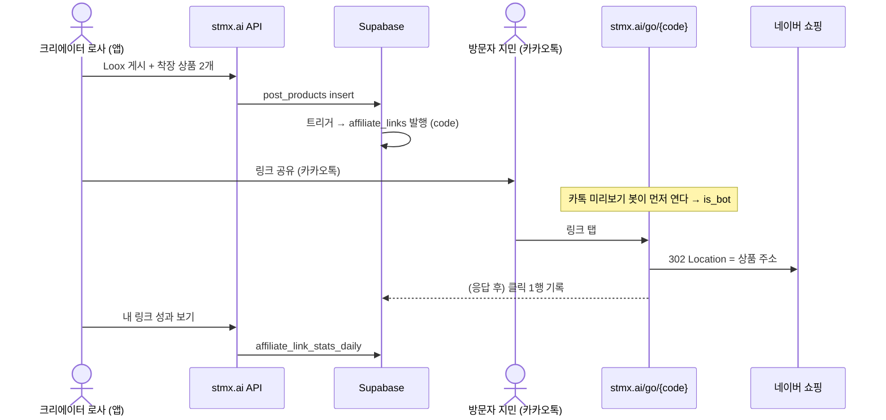

# 시연 시나리오 — 크리에이터 제휴 링크 발행 · 추적

| 항목 | 값 |
|---|---|
| 근거 명세 | [creator-link-tracking.md](creator-link-tracking.md) (규칙 번호 `R-*`, 수용 기준 `AC-*` 는 그 문서 기준) |
| 작성일 | 2026-10-13 |
| 소요 | 본 시연 약 15분 + 질의응답 |
| 한 줄 메시지 | "크리에이터가 평소처럼 Loox 에 상품을 붙이기만 하면 추적 링크가 생기고, 그 링크로 들어온 클릭이 크리에이터 몫으로 쌓인다." |

### 구현 상태 범례

시연 전에 반드시 알고 들어가야 한다. 지금 코드로 **실제 동작하는 장면**과 **대체 방법으로 보여 주는 장면**이 섞여 있다.

| 표시 | 뜻 |
|---|---|
| ✅ 실동작 | 코드가 있고 실제로 돈다 (P1-a 마이그레이션, P1-b 리다이렉터) |
| 🟡 대체 시연 | 화면이 아직 없어 SQL·브라우저 주소창으로 같은 결과를 보여 준다 |
| ⬜ 설명만 | 아직 구현되지 않은 단계(P1-c 이후, P2). 슬라이드나 말로 설명한다 |

---

## 1. 등장인물

| 역할 | 시연 계정/기기 | 하는 일 |
|---|---|---|
| **크리에이터 로사** | 휴대폰 A, STMX 앱, 데모 계정(닉네임 예: `demo_rosa`) | Loox 를 올리며 착장 상품을 붙인다, 링크를 공유한다 |
| **방문자 지민** | 휴대폰 B, 카카오톡 + 기본 브라우저 (STMX 로그인 불필요) | 공유받은 링크를 눌러 상품을 보러 간다 |
| **운영자** (발표자 보조) | 노트북, Supabase SQL Editor + 터미널 | 시스템 안에서 일어난 일을 화면에 띄운다 |
| **브랜드 담당자** (P2 설명용) | — | 자체몰 주문을 STMX 에 보고한다 |

---

## 2. 사전 준비 (리허설 체크리스트)

| # | 준비 | 확인 방법 |
|---|---|---|
| 1 | `supabase/migrations/20261013000000_affiliate_links.sql` 을 SQL Editor 에서 적용 | `select count(*) from affiliate_links;` 가 오류 없이 돈다 (기존 착장 상품 수만큼 백필돼 있다) |
| 2 | `/go/[code]` 리다이렉터가 들어간 웹 배포 (`stmx.ai`) — 또는 로컬 `npm run dev` (8910) | 아래 §3-0 의 curl 로 302 확인 |
| 3 | 데모 크리에이터 계정 로그인된 휴대폰 A | 앱에서 Loox 작성 화면 진입 가능 |
| 4 | 네이버 카탈로그가 등록된 브랜드 1곳 (vton `/brand-integration` 에서 확정된 브랜드) | 앱 착장 상품 검색에서 그 브랜드 상품이 나온다 |
| 5 | 휴대폰 B 와 휴대폰 A 의 카카오톡 대화방 | 링크를 보낼 수 있다 |
| 6 | 노트북에 SQL 탭 3개를 미리 열어 둔다: **링크 조회 / 클릭 조회 / 집계 조회** (§5 의 쿼리) | 닉네임·코드 자리만 바꿔 실행 |
| 7 | 발표 직전 시계를 본다 | 장면 4 의 "30분 dedupe" 는 같은 방문자의 클릭 간격으로 판정한다 |

> ⚠️ 운영 DB 를 공유한다. 데모 데이터는 데모 계정으로만 만들고, 끝나면 §7 정리 절차를 따른다.

---

## 3. 시연 흐름



### 3-0. 오프닝 (1분) — 문제 제기

**발표 멘트:** "지금 STMX 에서는 착장 상품을 누르면 네이버로 바로 넘어갑니다. 누가 어느 크리에이터 덕분에 넘어갔는지 아무것도 남지 않습니다. 크리에이터에게 성과를 보여 줄 수도, 수익을 나눌 수도 없습니다."

**보여 줄 것:** 휴대폰 A 에서 아무 Loox 의 **착장 확인하기** → 상품 카드 탭 → 네이버가 열린다. (기존 동작, [현행 분석](../../current/workflows/loox-product-outbound.md))

---

### 장면 1. 크리에이터가 Loox 를 올리며 상품을 붙인다 (3분) ✅

| 단계 | 사용자 액션 (로사, 휴대폰 A) | 화면 | 시스템에서 일어나는 일 |
|---|---|---|---|
| 1-1 | 하단 탭의 **+** 를 눌러 새 Loox 작성 | 사진 고르기 | — |
| 1-2 | 착장 사진 1장을 고르고 다음 | 작성 화면 (STYLE NOTE) | — |
| 1-3 | STYLE NOTE 에 한 줄 입력, TPO·STYLE TAG 1개씩 선택 | | — |
| 1-4 | **착장 상품** 의 **추가** 를 누른다 | 착장 상품 검색 | — |
| 1-5 | 준비한 브랜드를 고르고 상품 2개를 선택, 체크로 닫는다 | 고른 상품 2줄 | — |
| 1-6 | **완료** 로 게시 | "등록 완료 — 게시물이 등록되었습니다." | 게시물 저장 → `post_products` 2행 insert → **트리거가 행마다 `affiliate_links` 를 만들고 `post_products.link_code` 를 채운다** (R-LINK-1) |
| 1-7 | **게시물 확인** | 게시물 상세 | — |

**운영자 액션 (노트북):** SQL 탭 ① 링크 조회 실행.

**관객이 볼 것:** 방금 붙인 상품 2개에 대해 링크 2행이 생겨 있다.
- `code` 8자 무작위, `url` = `https://stmx.ai/go/xxxxxxxx`
- `creator` = 로사, `style_code` = 로사의 게시 시점 STMX 코드, `brand_id` 채워짐, `is_active = true`

**발표 멘트:** "크리에이터는 링크를 만든 적이 없습니다. 평소처럼 상품을 붙였을 뿐인데, 상품 × 게시물마다 로사 이름의 추적 링크가 생겼습니다. ShopMy 의 Pin 과 같은 개념인데, 같은 상품이라도 다른 게시물에 붙이면 링크가 따로 생겨 어느 게시물이 잘 팔렸는지 구분됩니다."

> 여기서 가져갈 값: 첫 번째 링크의 `code` → 이하 `<CODE>`.

---

### 장면 2. 크리에이터가 링크를 공유한다 (2분) 🟡

| 단계 | 사용자 액션 | 대체 방법 (지금) | 완성 후 (⬜ P1-d/P3) |
|---|---|---|---|
| 2-1 | 로사가 "내 링크" 에서 상품 링크를 복사 | 운영자가 SQL 결과의 `url` 을 복사해 휴대폰 A 로 보낸다 | 앱 "내 링크 성과" 화면의 복사 버튼 |
| 2-2 | 로사가 카카오톡으로 지민에게 링크 전송 | 동일 (실제 카카오톡 전송) | 동일 |

**관객이 볼 것:** 카카오톡 대화방에 `stmx.ai/go/...` 링크와 미리보기 카드.

**운영자 액션:** SQL 탭 ② 클릭 조회 실행.

**관객이 볼 것:** 아무도 누르지 않았는데 클릭 1행이 생겨 있다 — `is_bot = true`, UA `kakaotalk-scrap...`.

**발표 멘트:** "카카오톡이 미리보기를 만들려고 링크를 먼저 열어 봤습니다. 이런 건 봇으로 표시하고 크리에이터 집계에서는 뺍니다 (R-CLICK-4). 국내는 카카오·네이버 수집기가 많아서 이걸 거르지 않으면 숫자가 부풀려집니다."

> 미리보기 수집이 늦게 오거나 캐시돼 안 생길 수 있다. 그때는 터미널에서 대신 보여 준다:
> ```bash
> curl -s -o /dev/null -D - -A "kakaotalk-scrap/1.0" https://stmx.ai/go/<CODE>
> ```

---

### 장면 3. 방문자가 링크를 눌러 네이버로 간다 (2분) ✅

| 단계 | 사용자 액션 (지민, 휴대폰 B) | 화면 | 시스템 |
|---|---|---|---|
| 3-1 | 카카오톡에서 링크를 탭 | 잠깐 흰 화면 후 네이버 쇼핑 상품 페이지 | `/go/<CODE>` 가 링크를 찾고 목적지를 판정(naver) → **302** (R-REDIR-1, R-ROUTE-2) |
| 3-2 | (아무것도 안 함) | | 응답을 보낸 **뒤** 클릭 1행 기록 — 사람을 기다리게 하지 않는다 (R-CLICK-6) |

**운영자 액션:** SQL 탭 ② 클릭 조회 재실행.

**관객이 볼 것:** 새 클릭 1행 — `is_bot = false`, `src = external`, `route = naver`, `attributable = true`, `ip_hash` 는 64자 해시(원 IP 없음).

**보조 화면 (터미널, 선택):**
```bash
curl -s -o /dev/null -D - -A "Mozilla/5.0 (iPhone)" https://stmx.ai/go/<CODE>
```
→ `HTTP 302`, `location: https://search.shopping.naver.com/...` (주소 그대로, 파라미터 추가 없음), `set-cookie: stmx_vid=...; Path=/go`

**발표 멘트:** "판매처 입장에서는 그냥 네이버 링크로 들어온 손님입니다. 대신 우리 쪽에 '로사의 이 게시물의 이 상품'으로 들어온 클릭이 한 줄 남습니다."

---

### 장면 4. 같은 사람이 또 누른다 — 부풀리기 방지 (1분) ✅

| 단계 | 사용자 액션 (지민) | 시스템 |
|---|---|---|
| 4-1 | 뒤로 가서 같은 링크를 다시 탭 (장면 3 으로부터 30분 이내) | 클릭 1행 추가, 매번 새 `click_id` (AC-4) |

**운영자 액션:** SQL 탭 ③ 집계 조회.

**관객이 볼 것:**

| clicks | valid_clicks | bot_clicks |
|---|---|---|
| 3 | 1 | 1 |

**발표 멘트:** "원본 클릭은 전부 남기지만, 같은 사람이 30분 안에 다시 누른 건 한 번으로 셉니다. 크리에이터에게 보여 주는 숫자는 `valid_clicks` 입니다."

---

### 장면 5. 링크의 안전장치 (2분) ✅

| 단계 | 액션 | 기대 결과 | 규칙 |
|---|---|---|---|
| 5-1 | 운영자가 브라우저 주소창에 `https://stmx.ai/go/ZZZZZZZZ` | STMX 홈으로 이동, 클릭 기록 없음 | R-REDIR-2, AC-6 |
| 5-2 | 로사가 게시물 수정에서 상품 1개를 뺀다 → 지민이 그 링크를 다시 탭 | 여전히 네이버로 간다. 클릭은 `attributable = false` | R-LINK-3, R-REDIR-4, AC-8 |
| 5-3 | (설명) 누군가 `?url=https://evil.example` 을 붙여 보낸다 | 무시된다 — 목적지는 DB 값만 쓴다 | R-REDIR-3, AC-7 |
| 5-4 | 로사가 같은 상품을 다시 붙인다 → SQL 탭 ① | 링크가 새로 생기지 않고 **같은 코드**가 다시 켜진다 | R-LINK-2, AC-2 |

**발표 멘트:** "이미 퍼진 링크는 상품을 빼도 깨지지 않습니다. 다만 그 뒤 클릭은 수익 귀속에서 빠집니다. 다시 붙이면 같은 링크가 살아나 그동안의 기록이 이어집니다."

> 5-2 에서 앱에 상품 빼기 화면이 없으면 운영자가 vton `/products-2-link` 에서 해당 게시물의 상품을 뺀다(`post_products` 삭제 경로는 어디서든 같은 트리거를 탄다).

---

### 장면 6. 앱 안에서 상품을 누를 때 (1분) ⬜ P1-c

**지금:** 휴대폰 B 에서 STMX 앱으로 로사의 게시물 → **착장 확인하기** → 상품 탭 → 네이버로 **직행** (클릭 미기록).

**완성 후:** 같은 탭이 `https://stmx.ai/go/<CODE>?s=app` 을 열고 → 302 → 네이버. 클릭은 `src = app` 으로 남는다 (AC-9).

**발표 멘트:** "앱과 웹의 상품 버튼을 이 링크로 바꾸는 작업이 다음 단계입니다. DB 변경이 먼저 적용돼 있어야 해서 순서를 지켜 배포합니다."

---

### 장면 7. 크리에이터가 성과를 본다 (2분) 🟡 P1-d

| 단계 | 사용자 액션 (로사) | 대체 방법 (지금) | 완성 후 |
|---|---|---|---|
| 7-1 | 앱 프로필 → "내 링크 성과" | 운영자가 SQL 탭 ③ 을 링크별·게시물별로 보여 준다 | `GET /api/creator/links` 화면: 링크별 유효 클릭, 기간 필터, 주간 추이 |
| 7-2 | 게시물별로 정렬 | §5 의 게시물별 집계 쿼리 | 동일 |

**관객이 볼 것:** 로사의 게시물 → 상품 2개 → 각각 유효 클릭 수. 봇 클릭 수는 크리에이터 화면에 나오지 않는다 (R-STAT-2).

---

### 장면 8. 다음 단계 — 클릭이 수익이 되는 순간 (2분) ⬜ P2 (설명만)

네이버는 구매 정보를 돌려주지 않는다. 그래서 수익 귀속은 **자체몰을 가진 제휴 브랜드**부터 시작한다.

| 단계 | 누가 | 무슨 일 | 규칙 |
|---|---|---|---|
| 8-1 | 지민 | 로사의 링크(자체몰 상품)를 탭 | 302 Location 에 `stmx_click_id=<uuid>&utm_source=stmx&utm_medium=affiliate&utm_campaign=demo_rosa&utm_content=<CODE>` 가 붙는다 (R-ROUTE-3) |
| 8-2 | 지민 | 3일 뒤 그 자체몰에서 10만 원어치 구매 | 브랜드 사이트가 `stmx_click_id` 를 주문에 보관 |
| 8-3 | 브랜드 | 주문을 STMX 에 웹훅/CSV 로 보고 | 클릭 확인 → 브랜드 일치 → 7일 window 안 → 로사 승인 크리에이터 → **귀속** (R-ATTR-*) |
| 8-4 | 시스템 | 커미션 생성 | 요율 15%, 플랫폼 18% → **gross 15,000 / 플랫폼 2,700 / 로사 12,300원**, `pending` (AC-12) |
| 8-5 | 시스템 | 14일 반품기간 경과 + 브랜드 정산 입금 확인 | `locked` (R-COMM-4) |
| 8-6 | 시스템 | 다음 금요일 지급 배치 | `paid` |

**발표 멘트:** "커미션·지급 테이블은 이미 있습니다. 이번 작업은 그 앞단, 링크와 클릭을 만든 것입니다. 링크 → 클릭 → 주문 → 커미션의 사슬에서 처음 두 고리가 오늘 생겼습니다."

---

## 4. 시연 체크포인트 요약

| 장면 | 상태 | 확인할 값 | 수용 기준 |
|---|---|---|---|
| 1 | ✅ | 상품 수 = 링크 수, code 8자 | AC-1 |
| 2 | 🟡 | 카카오 미리보기 클릭 `is_bot = true` | AC-5 |
| 3 | ✅ | 302 Location = 네이버 주소 그대로, 클릭 1행 | AC-3 |
| 4 | ✅ | clicks 3 / valid 1 / bot 1 | AC-4 |
| 5 | ✅ | 없는 코드 → 홈 / 뺀 상품 → attributable false / 재연결 → 같은 코드 | AC-6, AC-8, AC-2 |
| 6 | ⬜ | (완성 후) `src = app` | AC-9 |
| 7 | 🟡 | 링크별 valid_clicks | AC-10 |
| 8 | ⬜ | gross 15,000 / net 12,300 | AC-12 |

---

## 5. 운영자용 쿼리

`<닉네임>`, `<CODE>` 만 바꿔 실행한다.

**① 링크 조회**
```sql
select l.code,
       'https://stmx.ai/go/' || l.code as url,
       p.name                         as product,
       l.post_id, l.style_code, l.brand_id,
       l.is_active, l.deactivated_reason, l.created_at
  from affiliate_links l
  join profiles pr on pr.id = l.creator_id
  join products p  on p.id  = l.product_id
 where pr.nickname = '<닉네임>'
 order by l.created_at desc;
```

**② 클릭 조회**
```sql
select created_at at time zone 'Asia/Seoul' as at_kst,
       src, route, is_bot, attributable,
       left(user_agent, 40) as ua,
       left(ip_hash, 12)    as ip_hash
  from affiliate_link_clicks
 where link_id = (select id from affiliate_links where code = '<CODE>')
 order by created_at desc;
```

**③ 집계 (링크별 오늘)**
```sql
select l.code, s.day_kst, s.clicks, s.valid_clicks, s.bot_clicks
  from affiliate_link_stats_daily s
  join affiliate_links l on l.id = s.link_id
 where l.code = '<CODE>';
```

**④ 게시물별 집계 (장면 7)**
```sql
select l.post_id, p.name as product, l.code,
       coalesce(sum(s.valid_clicks), 0) as valid_clicks
  from affiliate_links l
  join profiles pr on pr.id = l.creator_id
  join products p  on p.id  = l.product_id
  left join affiliate_link_stats_daily s on s.link_id = l.id
 where pr.nickname = '<닉네임>'
 group by l.post_id, p.name, l.code
 order by valid_clicks desc;
```

---

## 6. 예상 질문

| 질문 | 답 |
|---|---|
| 링크를 크리에이터가 직접 만들어야 하나? | 아니다. 상품을 붙이면 자동으로 생긴다. 외부 공유 전용 링크(Quick Link)는 P3 |
| 네이버 구매도 수익이 되나? | 지금은 클릭까지만. 네이버는 전환 데이터를 주지 않는다. 네이버 제휴 프로그램 연동은 별도 검토(D-2) |
| 같은 사람이 계속 누르면? | 원본은 다 남기고, 30분 안 재클릭은 유효 클릭에서 뺀다 |
| 개인정보는? | IP 원문을 저장하지 않는다(일자별 해시). 방문자 쿠키는 `/go` 경로에서만 쓰고 로그인과 연결하지 않는다 |
| 링크가 느려지지 않나? | 클릭 기록은 응답을 보낸 뒤에 한다. 기록이 실패해도 이동은 된다 |
| 휴대폰을 바꿔 사면? | 귀속되지 않는다(ShopMy 도 같다) |
| 링크를 위조해 다른 사이트로 보낼 수 있나? | 목적지는 DB 의 상품 주소만 쓰고, 네이버·제휴 브랜드 도메인이 아니면 보내지 않는다 |

---

## 7. 시연 후 정리

데모 계정으로 만든 게시물만 지운다. 게시물을 지우면 트리거가 링크를 `post_deleted` 로 끄고, `post_products` 는 함께 지워진다. 링크·클릭 행은 이력으로 남는 것이 정상 동작이다. 데모 기록까지 지워야 하면 아래를 **데모 닉네임으로만** 실행한다.

```sql
-- 1) 데모 클릭
delete from affiliate_link_clicks
 where link_id in (select l.id from affiliate_links l
                     join profiles pr on pr.id = l.creator_id
                    where pr.nickname = '<데모 닉네임>');
-- 2) 데모 링크를 가리키는 카드 코드 해제 후 링크 삭제
update post_products set link_code = null
 where link_code in (select l.code from affiliate_links l
                       join profiles pr on pr.id = l.creator_id
                      where pr.nickname = '<데모 닉네임>');
delete from affiliate_links
 where creator_id = (select id from profiles where nickname = '<데모 닉네임>');
```

*End of scenario*
