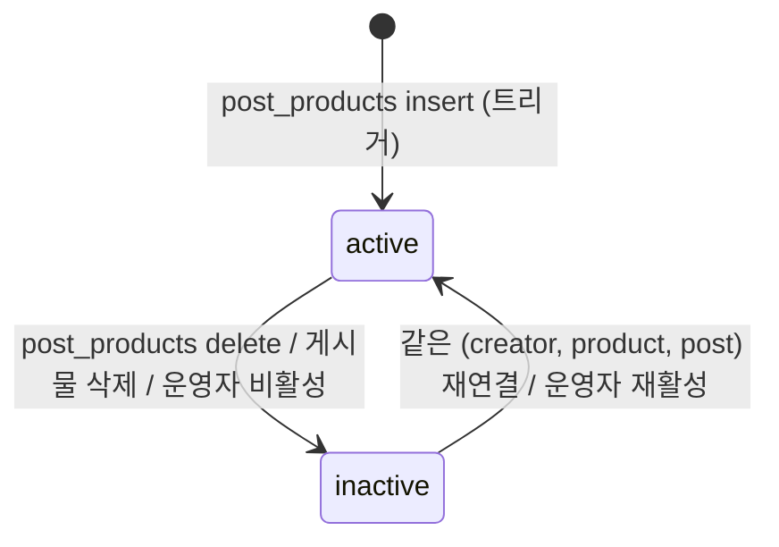
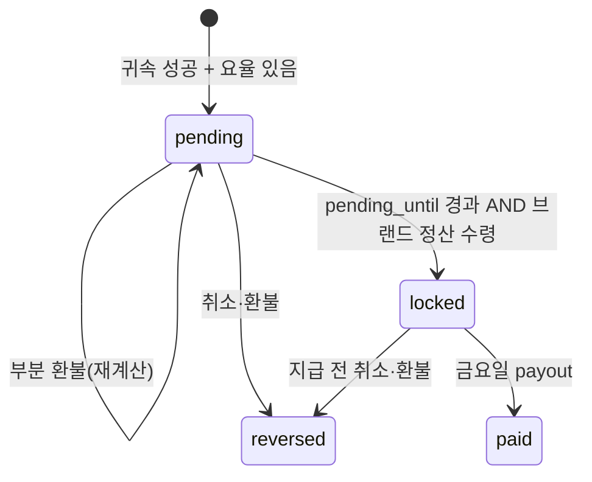

# 명세서 — 크리에이터 제휴 링크 발행 · 추적 (STMX)

| 항목 | 값 |
|---|---|
| 상태 | **proposal** · 2026-10-13 · P1-a(마이그레이션)·P1-b(리다이렉터) 코드 작성 완료, DB 미적용 |
| 대상 | stmx-web-phase2 (`apps/web` 리다이렉터·API, `apps/mobile` 아웃바운드) + vton (운영 화면) · 공유 Supabase |
| 역설계 원본 | [ShopMy BL](../../research/shopmy-link-tracking.md) · [증거 원장](../../research/shopmy-link-tracking-evidence.md) |
| 현행 | [Loox 상품 → 판매처 이동(현행)](../../current/workflows/loox-product-outbound.md) |
| 방법 | meirm/reverse-engineering-skill 의 BDD 파이프라인: extract(ShopMy·STMX) → gap → refine → acceptance. 테스트 생성은 구현 단계에서 |

---

## 0. 한 줄 요약

Loox 에 상품이 붙는 순간 **(작성자 × 상품 × 게시물) 마다 추적 링크 `stmx.ai/go/{code}` 를 자동 발행**하고, 모든 상품 탭을 이 리다이렉터로 보내 **서버 302 시점에 클릭을 기록**한다. 브랜드가 보고한 주문은 click id 로 **last-click 귀속**해 이미 있는 `affiliate_orders → commissions → payouts`(vton 0012)에 흘려 넣는다.

---

## 1. ShopMy → STMX 이식 판정

| ShopMy 로직 | 판정 | STMX 적용 |
|---|---|---|
| Pin = 자리(placement)마다 별도 링크 | **채택** | 링크 = (creator, product, post). 같은 상품이 다른 게시물에 붙으면 다른 링크 |
| `go.shopmy.us/p-{순번}` | **변형** | `stmx.ai/go/{8자 base62 무작위}` — 순번은 거래량을 노출하므로 쓰지 않는다 |
| 서버 302 시점 클릭 생성, 매 요청 새 clickId | **채택** | `affiliate_link_clicks.click_id uuid` |
| cid 문자열에 creator·pin·shopper 인코딩 | **거절** | 외부로는 불투명한 `click_id` 만 보낸다. 해석은 서버 조회로 (개인정보 최소화) |
| merchant 라우팅(직접 연동 vs 네트워크) | **변형** | `route`: `naver`(전환 신호 없음) / `direct_brand`(파라미터 부착 + 주문 보고) |
| 브랜드 사이트 pixel(1st-party 쿠키, cart attribute, confirm_click, 코드 자동 적용) | **연기(P3)** | P2 는 브랜드가 랜딩 URL 의 `stmx_click_id` 를 주문에 실어 보내는 방식(webhook/CSV) |
| 귀속 소스 click_id / landing_site / note_attributes / discount_code / ip_match | **부분 채택** | P2: click_id 만. P3: discount_code. ip_match 는 **채택 안 함**(오탐·개인정보) |
| last-click, 브랜드별 window(세션~30일, 흔히 7일) | **채택** | `brands.attribution_window_days` 기본 7, 1..30 |
| expired_click / cross_brand_click 버림 | **채택** | 수집 로그에 버림 사유로 남김 |
| full-cart commission | **채택** | 같은 브랜드 주문 전체 GMV 기준 |
| Link > Code | **채택(P3)** | 코드 도입 시 |
| 요율 우선순위 fixed > custom > SKU > merchant | **축소 채택** | P2: `brand_commission_rates`(카테고리·기간) > `brands.default_commission_rate_bps`. creator 개별 요율은 P3 |
| 82/18 분배 | **채택(이미 있음)** | `default_platform_cut_bps = 1800` |
| Pending → Locked(**현금 수령 기준**) → Paid(금요일, 최소액) | **채택** | 0012 상태 머신 재사용. Lock 조건 = 반품기간 경과 **and** 브랜드 입금 확인 |
| 지급 후 소급 차감 없음 | **채택(결정 필요 D-6)** | |
| Non-commissionable 링크도 생성 가능, 주문은 미집계 | **채택** | 모든 작성자에게 링크·클릭은 발행, 커미션은 승인 크리에이터만 |
| Wishlist 장기 귀속, Circles 분배, Opportunity, Spotlight, Amazon tag | **범위 밖** | 별도 명세 |
| auto-link(apx) 첫 클릭 시 생성 | **범위 밖** | 외부 공유용 Quick Link 는 P3 |

---

## 2. Gap 분석 (현행 STMX vs 목표)

| # | 심각도 | Gap | 해결 |
|---|---|---|---|
| G-1 | Critical | 상품 탭이 우리 서버를 거치지 않는다(웹 `<a>`·앱 `Linking.openURL` 직행) → 클릭 0 기록 | §6 리다이렉터 + §9 클라이언트 전환 |
| G-2 | Critical | 링크 엔티티 없음. `affiliate_orders.affiliate_link_id` 는 FK 없는 예약 컬럼 | §8 `affiliate_links` + FK |
| G-3 | Critical | 네이버는 전환 데이터를 주지 않는다 → 네이버 상품은 **클릭까지만** 추적 가능 | route=`naver` 는 커미션 없음을 정책으로 명시(R-ROUTE-2). 전환은 direct_brand 만 |
| G-4 | High | vton 은 로그인만 하면 누구나(게다가 publishable key 로도) API 호출 가능. 공유 DB 라 STMX 일반 사용자도 해당 | P0 에서 관리자 가드(`profiles.is_admin`) 추가 후에만 돈 관련 화면 |
| G-5 | High | `post_products` 쓰는 곳이 4곳(web 서버, vton, 작성자 RLS 직접, 백필 스크립트) | 링크 발행을 **DB 트리거**로 일원화 |
| G-6 | High | `products` 에 brand FK 없음(`brand_name` 텍스트) | `products.naver_product_id = brand_catalog_models.id → brand_id` 로 링크 생성 시 `brand_id` 스냅샷 |
| G-7 | High | 클라이언트 allowlist 가 naver 호스트만 허용 | `stmx.ai/go/` 를 허용 목록에 추가 |
| G-8 | Medium | 미적용 초안 `sqls/phase2/15_shopmy_commerce.sql` 이 0012 와 테이블 이름 충돌(`affiliate_orders`, `commissions`) | 초안은 **실행 금지**로 표기, links/clicks 부분만 이 명세 기준으로 새 마이그레이션 |
| G-9 | Medium | 주문 통화 KRW 인데 `payouts.currency` 기본 USD, provider paypal/stripe | P2 에서 KRW·`bank_transfer` 추가 (D-7) |
| G-10 | Medium | 카카오톡 링크 미리보기 등 크롤러가 링크를 열면 클릭으로 잡힌다 | 봇 판정(R-CLICK-4) |
| G-11 | Low | CI 가 `master` 만 빌드, 개발선은 `main` | 배포 경로 확인(D-1) |
| G-12 | Low | 유니버설 링크 대상 경로에 `/go` 가 들어가면 앱이 가로채 리다이렉트가 안 탄다 | `/go/*` 는 associated domains **에서 제외** 유지 |

---

## 3. 용어

[BDD/project_config.yaml](../../../BDD/project_config.yaml) 의 terminology 를 따른다. 이 문서에서 추가로:

| 용어 | 정의 |
|---|---|
| 링크 코드 (`code`) | 링크의 공개 식별자. 8자 base62 무작위 |
| route | 링크 목적지 종류. `naver` / `direct_brand` |
| 방문자 id (`visitor_id`) | `stmx.ai` 1st-party 쿠키 `stmx_vid`(uuid, 365일). 로그인과 무관 |
| 유효 클릭 | 봇이 아니고, 같은 (링크, 방문자) 30분 내 첫 클릭 |
| 수집(ingest) | 브랜드가 보낸 주문 한 줄을 받아 귀속 판정까지 하는 단위 |
| 수익화 가능 크리에이터 | 귀속 시점에 크리에이터 승인(CR)이 유효하고 탈퇴하지 않은 사용자 |

---

## 4. 업무 정책 (refined, 결정적 규칙)

### 4.1 링크 발행

- **R-LINK-1** `post_products` 에 행이 생기면 같은 트랜잭션에서 `affiliate_links` 를 발행한다: `creator_id = posts.author_id`, `product_id`, `post_id`, `style_code = posts.style_code`(스냅샷), `brand_id = brand_catalog_models.brand_id`(`products.naver_product_id` 로 조회, 없으면 null), `route = 'naver'`(brand 가 `affiliate_ready` 이고 `website_url` 이 있으면 `direct_brand` 가 아니라 **여전히 naver** — 목적지는 상품 URL 이 결정한다, R-ROUTE-1).
- **R-LINK-2** (creator, product, post) 조합당 링크는 **최대 1개**. 이미 있으면 재활성화(`is_active = true`)만 한다. 같은 상품을 다시 붙였다 떼도 코드와 클릭 이력이 유지된다.
- **R-LINK-3** `post_products` 행이 지워지면 링크를 **지우지 않고** `is_active = false`, `deactivated_reason = 'detached'`. 게시물 삭제 시에도 링크 행은 남긴다(`post_id` 는 set null 이 아니라 **cascade 금지** → `on delete set null` + `deactivated_reason = 'post_deleted'`).
- **R-LINK-4** 코드는 `[0-9A-Za-z]{8}` 무작위, 충돌 시 재생성(최대 5회). 순번·creator id 를 담지 않는다.
- **R-LINK-5** 링크는 **모든 작성자**에게 발행한다(크리에이터 승인 여부와 무관). 수익화 여부는 귀속 시점에 판정(R-ATTR-6). 이유: 승인 전 성과도 승인 심사 근거가 된다.
- **R-LINK-6** 링크의 목적지는 기본적으로 **조회 시점의 `products.naver_url`** 을 따른다(`destination_url` 이 null). `destination_url` 이 있으면 그것이 우선한다(운영자 override, direct_brand 용).

### 4.2 목적지 라우팅

- **R-ROUTE-1** 최종 목적지 = `coalesce(link.destination_url, product.naver_url)`. 호스트로 route 를 판정한다: naver 호스트 → `naver`, `brands.website_url`(또는 `brands.alt_domains`) 호스트 → `direct_brand`, 그 외 → **리다이렉트 거부**(R-REDIR-3).
- **R-ROUTE-2** `naver`: URL 을 **그대로** 보낸다(파라미터 부착 없음). 이 route 의 클릭은 커미션 귀속 대상이 아니다.
- **R-ROUTE-3** `direct_brand`: 기존 쿼리를 보존하고 다음을 덧붙인다(같은 키가 있으면 덮어씀): `stmx_click_id={click_id}`, `utm_source=stmx`, `utm_medium=affiliate`, `utm_campaign={creator nickname}`, `utm_content={code}`.

### 4.3 리다이렉트 · 클릭

- **R-REDIR-1** `GET https://stmx.ai/go/{code}` → 302. 응답은 `Cache-Control: no-store`, `Referrer-Policy: strict-origin-when-cross-origin`, `X-Robots-Tag: noindex`.
- **R-REDIR-2** 코드가 없으면 302 → `https://stmx.ai/` (클릭 기록 없음, 서버 로그만).
- **R-REDIR-3** 목적지가 R-ROUTE-1 허용 호스트가 아니거나 https 가 아니면 302 → 그 게시물의 Loox 페이지(없으면 홈). **쿼리스트링의 URL 은 절대 목적지로 쓰지 않는다**(open redirect 금지).
- **R-REDIR-4** 비활성 링크(`is_active = false`)라도 목적지가 유효하면 **보낸다**(사용자 경험 우선). 클릭은 기록하되 `attributable = false`.
- **R-CLICK-1** 리다이렉트 1회 = 클릭 1행. `click_id` 는 매번 새 uuid.
- **R-CLICK-2** 기록 필드: link id, click_id, visitor_id, `src`(`app` / `web` / `external`), 국가(헤더 `cf-ipcountry` 등 있을 때만), UA(앞 300자), `ip_hash` = sha256(IP + 일자별 salt) — **원 IP 저장 금지**, `is_bot`, `attributable`, 링크의 `creator_id`·`brand_id`·`style_code`·`route` 스냅샷.
- **R-CLICK-3** `src`: 쿼리 `?s=app`(앱이 붙임) → `app`; Referer 가 `stmx.ai` → `web`; 그 외 → `external`.
- **R-CLICK-4** 봇 판정: UA 가 `/bot|crawl|spider|slurp|preview|facebookexternalhit|kakaotalk-scrap|Yeti|Daum|Slackbot|Twitterbot|WhatsApp|TelegramBot|Discordbot|headless/i` 이거나 메서드가 `HEAD` → `is_bot = true`. 봇도 302 는 하되 집계·귀속에서 제외.
- **R-CLICK-5** 유효 클릭 = `is_bot = false` 이고 같은 (link, visitor_id) 의 직전 클릭이 30분 이전이거나 없음. 원본 행은 모두 저장, "유효"는 집계 시 계산.
- **R-CLICK-6** 클릭 기록 실패(DB 오류)가 리다이렉트를 막지 않는다. 기록은 best-effort, 302 는 반드시 나간다.
- **R-CLICK-7** 방문자 쿠키 `stmx_vid` 가 없으면 발급한다(`Secure; SameSite=Lax; Path=/go; Max-Age=31536000`). 앱 내 탭은 시스템 브라우저로 열리므로 쿠키는 브라우저별이다(교차 기기 미지원 — ShopMy 와 동일).

### 4.4 귀속 (P2, direct_brand 전용)

- **R-ATTR-1** 수집 입력: `{brand, external_order_id, purchased_at, gmv(할인 후 상품 소계, 배송·세금 제외, KRW 원 단위 정수), stmx_click_id?, status(paid|cancelled|refunded|partially_refunded), refunded_amount?}`.
- **R-ATTR-2** `stmx_click_id` 로 클릭을 찾는다. 없거나 모르는 값 → 버림 `no_click`.
- **R-ATTR-3** 클릭의 `brand_id` ≠ 주문 브랜드 → 버림 `cross_brand_click`.
- **R-ATTR-4** `purchased_at − click.created_at > brands.attribution_window_days` 일 → 버림 `expired_click`. `purchased_at < click.created_at` → 버림 `clock_skew`.
- **R-ATTR-5** 클릭이 `is_bot` 또는 `attributable = false` → 버림 `unattributable_click`.
- **R-ATTR-6** 링크 creator 가 수익화 가능하지 않음 → 버림 `creator_not_monetizable`.
- **R-ATTR-7** last-click 은 브랜드 사이트가 가장 최근 `stmx_click_id` 를 보관한다는 전제로 **보고된 click_id 를 그대로 신뢰**한다(우리 쪽에서 다른 클릭으로 바꾸지 않는다).
- **R-ATTR-8** 같은 (brand, external_order_id) 재수신은 **멱등**: 새 주문을 만들지 않고 상태 변화만 반영(R-COMM-5).
- **R-ATTR-9** 모든 수집 결과(귀속·버림)는 `affiliate_order_ingests` 에 남는다(브랜드 연동 상태 진단용 — ShopMy Brand Health 대응).

### 4.5 커미션 (P2, 0012 재사용)

- **R-COMM-1** 요율 결정: ① `brand_commission_rates` 중 `brand_id` 일치, 상품 카테고리 일치(없으면 카테고리 null 행), `effective_from ≤ purchased_at < coalesce(effective_to, ∞)` 인 행 ② 없으면 `brands.default_commission_rate_bps` ③ 그것도 없으면 **커미션 미생성**, 수집 결과 `non_commissionable`.
- **R-COMM-2** 금액(원 단위 정수, 내림): `gross = floor(gmv × rate_bps / 10000)`, `platform_cut = floor(gross × platform_cut_bps / 10000)`, `creator_net = gross − platform_cut`. (`commissions_split_adds_up` 제약 충족)
- **R-COMM-3** 생성 시 `status = pending`, `pending_until = purchased_at + brands.return_window_days`(기본 14일).
- **R-COMM-4** `pending → locked` 조건: `now() ≥ pending_until` **AND** 해당 주문이 포함된 브랜드 정산(`brand_settlements.status = 'received'`)이 존재. 일일 배치가 전이한다.
- **R-COMM-5** 주문 상태 반영: `cancelled`/`refunded` → `pending`·`locked` 이면 `reversed`; `partially_refunded` → `pending` 이면 gmv 를 줄여 R-COMM-2 재계산, `locked` 이면 운영자 검토 대기 플래그; `paid` 이후 변화 → **무시**(D-6).
- **R-COMM-6** `locked → paid` 는 기존 금요일 payout 배치가 담당(이 명세 범위 밖, D-7).

### 4.6 크리에이터 성과 조회

- **R-STAT-1** 크리에이터는 **자기 링크만** 본다: 링크별·게시물별·브랜드별 유효 클릭, 원 클릭, (P2) 주문 수, GMV, 커미션 상태별 합계. 기간 필터(기본 최근 30일), 주 단위 추이.
- **R-STAT-2** 봇 클릭 수는 크리에이터에게 노출하지 않는다(운영자만).

---

## 5. 상태 머신

### 5.1 링크



금지: 링크 행 삭제(클릭·주문 FK 가 restrict).

### 5.2 수집(ingest) 결과

`received → attributed | discarded(reason)`. 터미널. 재수신은 같은 행 갱신 + `attempts++`.

### 5.3 커미션 (0012 enum 그대로)



금지: `paid → *`, `reversed → *`.

---

## 6. 데이터 모델

마이그레이션 위치: `stmx-web-phase2/supabase/migrations/2026101300000x_*.sql` (공유 DB 의 정본). vton 은 읽기·운영 쓰기만.

### 6.1 P1

```sql
create table public.affiliate_links (
  id                 uuid primary key default gen_random_uuid(),
  code               varchar(16) not null unique check (code ~ '^[0-9A-Za-z]{8,16}$'),
  creator_id         uuid not null references public.profiles(id) on delete cascade,
  product_id         uuid not null references public.products(id) on delete restrict,
  post_id            uuid references public.posts(id) on delete set null,
  brand_id           uuid references public.brands(id) on delete set null,     -- 스냅샷 (R-LINK-1)
  style_code         varchar(4) references public.style_codes(style_code) on delete set null,
  destination_url    text check (destination_url is null or destination_url ~* '^https://'),
  source             text not null default 'loox' check (source in ('loox','quick')),
  is_active          boolean not null default true,
  deactivated_reason text check (deactivated_reason in ('detached','post_deleted','admin')),
  created_at         timestamptz not null default now(),
  updated_at         timestamptz not null default now()
);
create unique index affiliate_links_placement_uq
  on public.affiliate_links (creator_id, product_id, post_id) where post_id is not null;

create table public.affiliate_link_clicks (
  id            bigint generated always as identity primary key,
  click_id      uuid not null unique default gen_random_uuid(),
  link_id       uuid not null references public.affiliate_links(id) on delete restrict,
  creator_id    uuid not null,          -- 스냅샷 (집계 인덱스용, FK 없음)
  brand_id      uuid,
  style_code    varchar(4),
  route         text not null check (route in ('naver','direct_brand')),
  src           text not null check (src in ('app','web','external')),
  visitor_id    uuid,
  ip_hash       text,
  country       char(2),
  user_agent    varchar(300),
  is_bot        boolean not null default false,
  attributable  boolean not null default true,
  created_at    timestamptz not null default now()
);
-- 인덱스: (link_id, created_at desc), (creator_id, created_at desc), (link_id, visitor_id, created_at desc)
```

- 트리거 `post_products_issue_affiliate_link` (after insert) / `post_products_deactivate_affiliate_link` (after delete) — `security definer`, R-LINK-1~4.
- 백필: 기존 `post_products` 전부에 링크 발행(일회성 SQL).
- RLS: `affiliate_links` select = `creator_id = auth.uid()` 또는 링크가 붙은 게시물이 공개(카드 href 를 그리기 위해 code 만 필요) → **뷰 `post_product_links(post_id, product_id, code)`** 를 공개로 두고 테이블 자체는 본인만. `affiliate_link_clicks` 는 RLS on, 정책 없음(서버 service role 전용).
- 집계 뷰 `affiliate_link_stats_daily(link_id, creator_id, day_kst, clicks, valid_clicks, bot_clicks)`.

### 6.2 P2

```sql
alter table public.brands
  add column attribution_window_days smallint not null default 7 check (attribution_window_days between 1 and 30),
  add column return_window_days      smallint not null default 14 check (return_window_days between 0 and 120),
  add column alt_domains             text[] not null default '{}',
  add column ingest_secret_hash      text;           -- 웹훅 HMAC 키(해시만 저장)

alter table public.affiliate_orders
  add constraint affiliate_orders_link_fk foreign key (affiliate_link_id) references public.affiliate_links(id) on delete restrict,
  add column attributed_click_id uuid references public.affiliate_link_clicks(click_id) on delete restrict;

create table public.affiliate_order_ingests (     -- R-ATTR-9
  id bigint generated always as identity primary key,
  brand_id uuid not null references public.brands(id),
  external_order_id text not null,
  payload jsonb not null,
  channel text not null check (channel in ('webhook','csv','admin')),
  result text not null check (result in ('received','attributed','discarded')),
  discard_reason text,      -- no_click | cross_brand_click | expired_click | clock_skew | unattributable_click | creator_not_monetizable | non_commissionable
  affiliate_order_id uuid references public.affiliate_orders(id),
  attempts int not null default 1,
  received_at timestamptz not null default now(),
  unique (brand_id, external_order_id)
);

create table public.brand_settlements (            -- R-COMM-4 (현금 수령 기준 lock)
  id uuid primary key default gen_random_uuid(),
  brand_id uuid not null references public.brands(id),
  period_start date not null, period_end date not null,
  amount_krw bigint not null check (amount_krw >= 0),
  status text not null default 'invoiced' check (status in ('invoiced','received','void')),
  received_at timestamptz, created_at timestamptz not null default now()
);
```

---

## 7. 인터페이스

| Phase | 위치 | 엔드포인트 | 설명 |
|---|---|---|---|
| P1 | apps/web | `GET /go/[code]` (route handler) | §4.3. service role 로 링크 조회·클릭 insert |
| P1 | apps/web | `GET /api/creator/links?from&to` | Bearer(`requireUser`). 본인 링크별 집계 (R-STAT-1) |
| P1 | apps/web | `GET /api/creator/links/summary?from&to` | 기간 합계 + 주 단위 추이 |
| P1 | apps/web | 기존 Loox 상세/검색 API | 상품 항목에 `link_url`(`https://stmx.ai/go/{code}`) 필드 추가 |
| P1 | packages/core | `api/creator-links.ts` | 위 응답 타입 |
| P1 | vton | `/affiliate-links` 화면 + `GET /api/admin/affiliate-links` | 운영자: 전 링크 검색, 클릭(봇 포함), 비활성/재활성 |
| P2 | apps/web | `POST /api/affiliate/orders` | 브랜드 웹훅. `X-STMX-Brand`, `X-STMX-Signature: sha256=HMAC(body)`. §4.4 |
| P2 | vton | `/affiliate-orders` 화면 + CSV 업로드 | 수집 로그·버림 사유·재처리, 브랜드 정산 등록(received 처리) |
| P2 | apps/web | 일일 배치 `POST /api/cron/commissions-lock` (CRON_SECRET) | R-COMM-4 |

## 8. 클라이언트 변경 (P1)

- **웹** `LooxNaverLinkModal`: "이동" 버튼 href 를 `link_url` 로. `link_url` 이 없으면(발행 전 데이터) 기존 `naver_url` 직행 폴백.
- **앱** `naver-shopping.ts`: `openProductLink(item)` 신설 — `link_url` 이 `https://stmx.ai/go/` 로 시작하면 `?s=app` 붙여 `Linking.openURL`, 아니면 기존 `openNaverShopping`. 허용 검사에 `stmx.ai/go/` 추가.
- **앱** `app.json` associated domains / intent filter 에 `/go` **추가하지 않음**(G-12).
- **앱** 크리에이터 "내 링크 성과" 화면(P1 후반): `GET /api/creator/links`.

## 9. 보안 · 개인정보

- vton 관리자 가드(P0): `proxy.ts`·`authenticate()` 가 `profiles.is_admin = true` 만 통과, publishable key 를 bearer 로 받는 경로 제거(또는 `/api/public/*` 로 한정).
- 리다이렉터는 DB 값만 목적지로 쓴다(R-REDIR-3). 코드 열거 공격 대비: 8자 base62 = 2.18×10¹⁴, 존재하지 않는 코드는 클릭 미기록.
- IP 원문 미저장, 일자별 salt 해시(R-CLICK-2). UA 300자 절단. 클릭 원본 보존 13개월 후 일 단위 집계만 남기고 삭제(P2 배치).
- 웹훅 HMAC 키는 해시로만 저장, 원문은 발급 시 1회 노출.

---

## 10. 수용 기준 (Given / When / Then)

**AC-1 링크 자동 발행**
Given 작성자 A 의 게시물 P 에 상품 X 가 없다
When `post_products(P, X)` 가 어떤 경로로든 insert 된다
Then `affiliate_links(creator=A, product=X, post=P, is_active=true)` 가 정확히 1행 존재하고 code 는 `^[0-9A-Za-z]{8}$`

**AC-2 재연결 시 코드 유지**
Given AC-1 의 링크 L(code=c) 이 있다
When (P, X) 를 떼었다 다시 붙인다
Then 링크 수는 1, code 는 여전히 c, `is_active = true`

**AC-3 네이버 리다이렉트**
Given 활성 링크 L 의 상품 `naver_url = U`
When `GET /go/{c}` (일반 브라우저 UA)
Then 302 Location = U (쿼리 변경 없음), 클릭 1행(route=naver, is_bot=false, src=external)

**AC-4 매 요청 새 click_id**
When 같은 방문자가 `GET /go/{c}` 를 두 번 한다
Then 클릭 2행, click_id 서로 다름, 유효 클릭 집계는 1

**AC-5 봇**
When UA `kakaotalk-scrap/1.0` 으로 `GET /go/{c}`
Then 302 는 나가고, 클릭 행 `is_bot = true`, 크리에이터 집계에 포함 안 됨

**AC-6 없는 코드**
When `GET /go/ZZZZZZZZ`
Then 302 → `https://stmx.ai/`, 클릭 행 없음

**AC-7 open redirect 차단**
Given 링크 L 의 `destination_url = https://evil.example/`
When `GET /go/{c}`
Then 302 → Loox 게시물 페이지, evil.example 로 가지 않음

**AC-8 비활성 링크**
Given L 이 `is_active = false`
When `GET /go/{c}`
Then 302 → 목적지, 클릭 `attributable = false`

**AC-9 앱 src**
When 앱이 `https://stmx.ai/go/{c}?s=app` 을 연다
Then 클릭 `src = app`, Location 에 `s` 파라미터가 남지 않음

**AC-10 본인 링크만 조회**
Given 크리에이터 A, B 각자 링크
When A 의 토큰으로 `GET /api/creator/links`
Then A 의 링크만, 봇 클릭 수 필드 없음

**AC-11 direct_brand 파라미터 (P2)**
Given 브랜드 Bd(`website_url=https://shop.bd.kr`) 상품 링크 L
When `GET /go/{c}`
Then Location 에 `stmx_click_id={새 click_id}&utm_source=stmx&utm_medium=affiliate&utm_campaign={nickname}&utm_content={c}`

**AC-12 귀속 성공 → pending 커미션 (P2)**
Given AC-11 의 click k(1일 전), Bd 요율 1500bps, cut 1800bps, window 7일, A 는 승인 크리에이터
When Bd 가 `{order 1001, gmv 100000, stmx_click_id k}` 를 보낸다
Then `affiliate_orders` 1행(link=L, attributed_click_id=k), `commissions(gross 15000, cut 2700, net 12300, pending, pending_until = purchased_at+14일)`

**AC-13 만료 클릭 (P2)** — click 이 8일 전 → 수집 `discarded/expired_click`, 주문·커미션 없음
**AC-14 다른 브랜드 클릭 (P2)** — click.brand ≠ 주문 brand → `discarded/cross_brand_click`
**AC-15 멱등 (P2)** — 같은 order 를 두 번 → 주문·커미션 각 1행, ingest `attempts = 2`
**AC-16 취소 (P2)** — pending 커미션 주문이 `cancelled` 로 재수신 → `reversed`
**AC-17 lock 조건 (P2)** — `pending_until` 경과했어도 브랜드 정산 미수령이면 `pending` 유지; 정산 `received` 후 배치 → `locked`
**AC-18 지급 후 환불 무시 (P2)** — `paid` 커미션 주문이 `refunded` 로 와도 상태 불변, ingest 에 기록만

---

## 11. 단계별 작업

| Phase | 작업 | 저장소 |
|---|---|---|
| **P0** | vton 관리자 가드 / 배포 브랜치 확인(D-1) / 초안 15 에 "실행 금지" 주석 | vton, phase2 |
| **P1-a** | 마이그레이션: links, clicks, 트리거, 공개 뷰, 집계 뷰, 백필 | phase2 `supabase/migrations` |
| **P1-b** | `/go/[code]` 리다이렉터 + 봇 판정 + 방문자 쿠키 | phase2 `apps/web` |
| **P1-c** | Loox API 응답에 `link_url`, 웹 모달·앱 아웃바운드 전환 | phase2 `apps/web`, `apps/mobile`, `packages/core` |
| **P1-d** | `GET /api/creator/links[/summary]` + 앱 성과 화면 | phase2 |
| **P1-e** | vton `/affiliate-links` 운영 화면 | vton |
| **P2** | brands 컬럼, ingests, settlements, 웹훅, CSV, 귀속 엔진, lock 배치, vton 화면 | phase2, vton |
| **P3** | 브랜드 사이트 pixel(`stmx_clicktrack.js`), 크리에이터 할인코드(Link > Code), creator×brand 개별 요율, Quick Link(외부 공유용) | — |

**진행 (2026-10-13)**
- P1-a `stmx-web-phase2/supabase/migrations/20261013000000_affiliate_links.sql` — 링크 코드를 별도 뷰 대신 `post_products.link_code` 에 실었다(기존 `select("position, product:products(*)")` 에 열 하나만 더하면 됨). PGlite 로 백필·AC-1·AC-2·떼기·운영자 비활성 유지·게시물 삭제·30분 dedupe 집계 검증 통과.
- P1-b `stmx-web-phase2/apps/web/app/go/[code]/route.ts` + `packages/core/src/affiliate-link.ts`(순수 규칙) + `packages/core/test/affiliate-link.test.ts`(`node --test`, 8건 통과).
- **순서 주의**: P1-c(클라이언트가 `link_code` 를 select) 는 마이그레이션 적용 **후** 배포해야 한다. 먼저 배포하면 없는 열을 읽어 상품 목록이 깨진다.

테스트: 규칙 R-* 마다 단위 테스트(라우팅·봇·유효클릭·귀속·금액 계산은 순수 함수로 `packages/core/src/affiliate/*` 에 둔다), AC-1~2 는 SQL 트리거 테스트, AC-3~9 는 route handler 테스트.

---

## 12. 결정 필요 (기본값을 정해 두고 진행)

| # | 질문 | 기본값(이 명세가 가정) |
|---|---|---|
| D-1 | 프로덕션은 `master` 인가 `main` 인가 | `main` 기준으로 개발, 배포 전 확인 |
| D-2 | 네이버 상품은 커미션 없이 클릭만 추적해도 되는가 (네이버 쇼핑 커넥트 등 별도 제휴 검토?) | 예. P1 은 클릭·성과 노출까지 |
| D-3 | 승인 전 작성자에게도 링크·성과를 보여줄 것인가 | 링크·클릭은 발행, 성과 화면은 승인 크리에이터만 |
| D-4 | 리다이렉터 경로 | `stmx.ai/go/{code}` |
| D-5 | 기본 window / 반품기간 | 7일 / 14일 (브랜드별 변경) |
| D-6 | 지급 후 환불 소급 차감 | 하지 않음(ShopMy 동일, 플랫폼 부담) |
| D-7 | 지급 통화·수단·원천징수(사업소득 3.3%) | P2 에서 KRW·계좌이체로 payouts 확장, 세무는 별도 명세 |
| D-8 | 수익화 가능 크리에이터 판정 소스 | `user_biz_request(code='CR')` 승인 상태 + `profiles.withdrawn_at is null` (컬럼 확인 필요) |

*End of specification*
