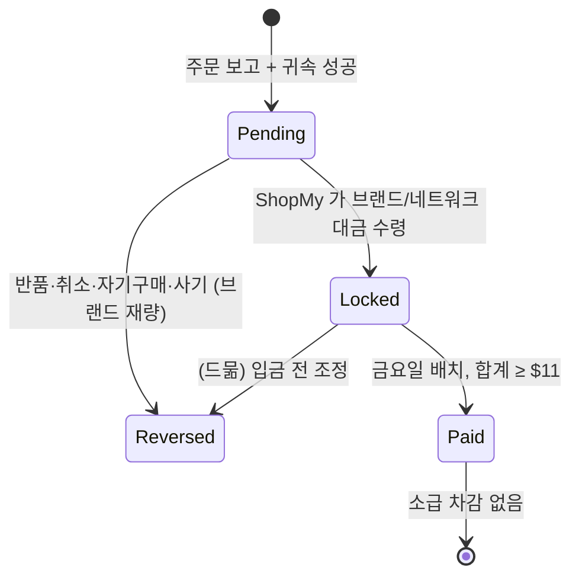

# ShopMy — 크리에이터 링크 발행 · 추적 비즈니스 로직 (블랙박스 역설계)

*2026-10-13 작성. 스킬: reverse-engineering-business-logic (Workflow-to-BL), 단 소스 코드 대신 **공개 문서 · 익명 HTTP 관찰 · 공개 SPA 번들**을 근거로 삼았다.*
*근거 원장: [shopmy-link-tracking-evidence.md](shopmy-link-tracking-evidence.md) — 아래 `[E§n]` 은 그 파일의 절 번호다.*

## 1. Business Purpose

크리에이터가 어떤 상품이든 **자기 이름이 박힌 단축 링크(Pin)** 로 만들어 퍼뜨리고, 그 링크를 거친 구매에 대해 브랜드가 주는 커미션을 받게 한다. ShopMy 는 링크 리다이렉트 시점에 클릭을 기록하고, 브랜드(직접 연동) 또는 제휴 네트워크(Impact 등)가 보고하는 주문을 그 클릭에 귀속시켜 커미션을 정산한다. [E§1, §3]

## 2. Actors

- **Creator**: Pin·Collection 을 만들고 공유한다. 커미션을 받는다.
- **Shopper**: 링크를 누르고 구매한다. 로그인 시 Wishlist·Circle 을 가진다.
- **Brand Partner (직접 연동)**: Shopify 등으로 ShopMy 에 붙어 pixel·주문 webhook 을 준다. 요율·코드·커스텀 요율을 정한다.
- **Commissionable Partner (네트워크 경유 retailer)**: Impact/Rakuten/CJ 등을 통해서만 요율과 주문 리포트를 준다.
- **ShopMy 리다이렉터**: `go.shopmy.us` — 클릭 기록 + 라우팅.
- **Manager/Agency**: Opportunity 수익에 take rate 를 건다(링크 추적과는 무관).

## 3. Preconditions

- Pin 은 **어떤 URL 이든** 만들 수 있지만, merchant 가 0% 또는 non-commissionable 이면 주문이 아예 집계되지 않는다. [E§2.1]
- 직접 연동 브랜드는 click pixel(`sms_aff_clicktrack.js`)과 주문 webhook 이 정상이어야 귀속된다(Brand Health 모니터링). [E§3.3–3.4]
- 지급에는 Stripe/PayPal 계정과 legal name 이 필요하다. [E§6]

## 4. Main Flow

1. **링크 발행**: 카탈로그 검색 / URL 붙여넣기 / Snapshop·Safari 확장 / auto-link 스크립트로 Pin 을 만든다. 같은 상품이라도 **놓이는 자리(Collection, 게시물)마다 별도 Pin** 이 생겨 성과가 분리된다. [E§2.1]
2. **merchant 결정**: URL 의 domain 으로 merchant 프로그램들을 찾고 가장 높은 요율의 "winner" 를 Pin 의 `merchant_data` 로 스냅샷한다. retailer 를 나중에 바꿔도 Pin id(URL)는 유지된다. [E§1, §2.1]
3. **클릭**: `go.shopmy.us/p-{PinId}` 요청마다 서버가 새 `clickId`(UUID)와 `cid`(creator·circle·pin·shopper·src·token) 를 만들고 302 한다. [E§3.1–3.2]
4. **라우팅**:
   - 직접 연동 → `apiv3/redirect_click` → 브랜드 사이트(`smsclickid`, `smscode`, utm_*)
   - 네트워크 → 네트워크 트래킹 URL(`subId1 = cid`), ShopMy 회사 publisher 계정 하나로 sub-affiliate
5. **브랜드 사이트 측(직접 연동)**: pixel 이 1st-party 쿠키(기본 30일)·Shopify cart attribute 에 click id 를 심고 `confirm_click` 으로 확인, 크리에이터 할인코드를 자동 적용. [E§3.3]
6. **주문 수신**: Shopify webhook(created/updated/fulfilled/cancelled) + nightly sync, 또는 네트워크 리포트. 최대 7일 지연. [E§3.4, §5.1]
7. **귀속**: click_id / landing_site / note_attributes / discount_code / offer / ip_match 중 하나로 클릭(또는 코드)을 찾고 window·브랜드 일치 검사. [E§3.4]
8. **커미션 생성**: 할인 후 subtotal(배송·세금 제외) × 요율 × creator share(82%). Pending 으로 시작. [E§5.2]
9. **확정**: 브랜드/네트워크 대금이 **ShopMy 에 실제 입금된 시점**에 Locked. [E§5.1]
10. **지급**: 매주 금요일, Locked 합계 ≥ $11 이면 Paid. [E§6]

## 5. Decision Rules

| Condition | Action | 근거 |
|---|---|---|
| merchant 가 non-commissionable/0% | 클릭만 기록, 주문 미집계 | E§2.1 |
| merchant.rateType ∈ {fixed_fee, flat_fee} | 그 요율 우선 | E§5.2 |
| creator×brand CustomRate 존재 | merchant 기본보다 우선 (신규/재구매 별도 가능) | E§5.2 |
| SKU/CatalogGroup 요율 존재 | 그중 최대값, 브랜드 최소 5% | E§5.2 |
| 그 외 | merchant(브랜드) 기본 요율 | E§5.2 |
| 직접 연동 + 브랜드 fee 모델 | creator 100% / 아니면 82% | E§5.2 |
| 링크 클릭 후 다른 크리에이터 코드 사용 | **링크가 이긴다** | E§4 |
| 링크 클릭 없음 + 크리에이터 코드 사용 | 코드 주인에게 귀속 | E§4 |
| 클릭 시각 + window < 주문 시각 | `expired_click` 으로 버림 | E§3.4 |
| 클릭의 브랜드 ≠ 주문 브랜드 | `cross_brand_click` 으로 버림 | E§3.4 |
| 같은 상품을 다른 Collection 에 추가 | 새 Pin (별도 추적) | E§2.1 |
| 링크 상품 아닌 다른 상품 구매 | 같은 retailer 의 commissionable 전체에 커미션(full-cart) | E§4 |
| 기기 변경 / 시크릿 / 앱 구매 | 미귀속 (cross-device 미지원) | E§4 |
| 지급 후 반품 | 소급 차감 없음 | E§5.1 |

## 6. State Transitions

Pin 자체는 상태가 단순하다: 활성 / hidden / monetization 비활성(`disable_monetization`).

## 7. Billing / Credit Impact

| Event | Impact |
|---|---|
| 클릭 | 금전 영향 없음. 로그만 |
| 주문 귀속 | Pending 커미션 = base × rate × share |
| 브랜드 대금 입금 | Locked (지급 가능) |
| 반품(지급 전) | Reversed, 음수 행으로 표시 |
| 반품(지급 후) | 영향 없음 (ShopMy 부담) |
| ShopMy 몫 | 표시 요율에 이미 반영된 18%, 또는 브랜드에 GMV fee(2.9~3.9%, 3rd-party) |

## 8. Exceptions / Edge Cases

- 존재하지 않는 Pin id → 302 홈으로. [E§2.2]
- Amazon: creator 의 Associates tag 를 붙이고 Amazon 이 직접 지급(ShopMy 장부 밖). tag 가 없으면 ShopMy 자체 tag. [E§2.1]
- auto-link(`apx`)는 첫 클릭 때 Pin 을 만든다 → 존재하지 않던 링크도 클릭되면 생긴다. [E§3.1-C]
- Wishlist 저장 시점에 크리에이터 귀속이 고정되어 window 를 넘어 장기 유지된다(구현 방식 미상). [E§4]
- Circle 판매는 원 커미션이 아니라 주간 보너스로 재분배된다. [E§4]

## 9. Data Written / Read

- **Written**: Pin(링크·merchant 스냅샷), Click(clickId, cid), confirm_click 결과, AffiliateCommission(주문·금액·상태), Payout/Payment.
- **Read**: Merchant 프로그램·요율 표, CustomRate, SKU 요율, brand attribution window, Brand Health.

## 10. Ambiguities / Questions

evidence 파일 "Unknowns" 14개를 그대로 승계한다. STMX 설계에 영향이 큰 것만:
- ⚠️ 귀속 소스 간 정확한 우선순위(link > code 만 확정).
- ⚠️ Pending→Locked 를 주문 단위로 하는지 인보이스 단위로 일괄 하는지.
- ⚠️ 클릭 dedupe·봇 필터 규칙.

## 11. Code References (관찰 근거)

- 리다이렉트 hop: evidence `observed:hop-direct`, `observed:hop-impact`, `observed:apx`
- cid 문법·요율 우선순위·귀속 소스 enum: `observed:spa-bundle` (`shopmy.us/static/js/main.0dfd86dc.js`)
- 브랜드 pixel: `observed:clicktrack-js` (`static.shopmy.us/Affiliates/sms_aff_clicktrack.js` v2.1.1)
- 정책: evidence §0.1 의 help center 문서 키

*End of analysis*
