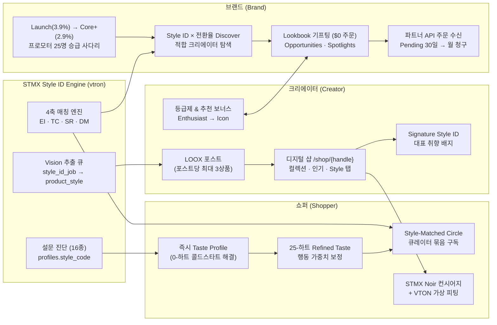
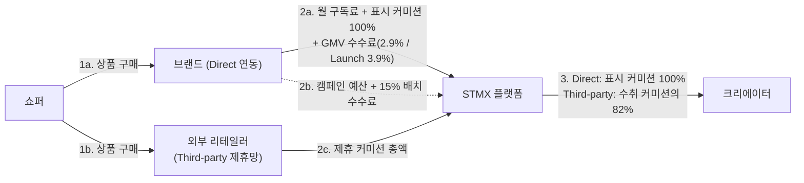

# STMX Style ID 연동 큐레이션 커머스 (ShopMy Clone+) 구현 스펙

> **스펙 경로:** `vtron/specs/stmx-shopmy-style-id-spec.md`  
> **기반 자료:** 《ShopMy 분석 — Craft Anything 활용》(2026-11-11 KST) + `vtron` 스키마(`0001`~`0025`)  
> **구현 대상:** `vtron` (Next.js Admin · Partner/Commerce API · Worker), `stmx-web` (쇼퍼·크리에이터·브랜드 웹), `stmx-app` (Expo iOS · Android 앱)  
> **작성일:** 2026-11-11 (Asia/Seoul)  
> **언어 규칙:** 문서·UI 카피는 한국어, 코드·DB 식별자·API 경로는 영어

---

## 0. 목적 및 핵심 설계 원칙

본 문서는 두 가지 목적을 동시에 달성하기 위한 실행 명세서(Implementation Spec)다.

1. **Craft Anything 기반 ShopMy App 분석 보완:** 기존 제출된 PDF 보고서가 `craft-anything-cli 0.6.0 --clean-room` 모드로 공개 웹 32개 URL만 비로그인 캡처하면서 남긴 한계(앱 내부 UI 미확인, 로그인 상태 플로우 미수집, `[미검증]` 7개 항목)를 해소하는 **앱·세션 보완 조사 프로토콜**을 정의한다.
2. **STMX Style ID × ShopMy 클론 서비스 구현 명세:** ShopMy의 검증된 3자(브랜드·크리에이터·쇼퍼) 수익·큐레이션 구조 위에 STMX 고유의 **4축 16종 Style ID(`^[EI][TC][SR][DM]$`)**, **LOOX 쇼핑 포스트(포스트당 최대 3상품)**, **가상 피팅(VTON)**, **iOS·Android 동시 지원**을 결합한 전체 데이터 모델·비즈니스 로직·API·화면 스펙을 고정한다.

### 0.1 아키텍처 불변 원칙 (Guardrails)

1. **`commerce_brands` 평행 테이블 신설 금지:** 기존 `vtron/supabase/migrations/0008_brands_shopmy.sql` 원칙에 따라 모든 브랜드 제휴·구독·카탈로그 메타는 `public.brands`를 단일 소유자(Single Source of Truth)로 확장한다.
2. **ShopMy 자체 제휴 링크 재활용 절대 금지:** ShopMy 이용약관(TOS)은 타 플랫폼 크리에이터 보상·보조·캐시백 목적의 링크 재활용을 명시적으로 금지한다(분석 PDF p.6). STMX는 자체 단축·트래킹 도메인(`/r/{code}`)과 자체 파트너 전환 API·제휴 네트워크 연동만 사용한다.
3. **수수료 정밀도 고정:** 모든 요율은 정수 **bps(`1 bps = 0.01%`, `10000 = 100%`)**, 금액은 통화 최소 단위 정수(`cents` 또는 `KRW` 원 단위 정수 + `currency char(3)`)로 저장하며 부동소수점 연산을 금지한다.
4. **멀티 Supabase 토폴로지 준수:** 소비자 앱(`stmx-app`, `ttcbqxmljloxaaqytxsm`)과 커머스·운영 엔진(`vtron`, `vteqjxebptdbkbrxyxiz`) 간 직접 크로스 DB 쓰기를 금지하고, `vtron`의 `/api/mobile/*` 및 `/api/v1/*` 서버 라우트(Service Role)를 통해서만 트랜잭션을 처리한다.
5. **Clean-room 및 보안 경계 준수:** `craft-anything` 보완 분석 시 바이너리 역공학(IPA 복호화·디컴파일), 비인가 패킷 가로채기, 봇 차단 우회를 수행하지 않으며, 테스트 계정 로그인 화면·실기기 화면 캡처 기반의 기능·UX 관찰 증거만 수집한다.

---

## 1. Part I — Craft Anything 기반 ShopMy App 보완 분석 프로토콜

### 1.1 기존 웹사이트 분석 PDF의 한계와 보완 범위

| 구분 | 기존 PDF 조사 결과 (`shopmy.cany`) | 한계점 / 누락 영역 | 본 스펙의 보완 방법 |
|---|---|---|---|
| **조사 대상** | 공개 웹 32개 URL + App Store 웹 등록 페이지 | 로그인 이후 쇼퍼·크리에이터·브랜드 실제 워크스페이스 미확인 | 테스트 계정 세션 기반 모바일/데스크톱 뷰포트 상태 캡처 + 실기기 앱 화면 증거화 |
| **앱 분석** | iTunes Lookup API + 스토어 스크린샷 4장 확인 | iOS 전용 앱(`v3.0.7`) 내부 탭 전환(쇼퍼↔크리에이터 겸용), 공유 시트 링크 생성 UX 미상세 | iPhone 실기기 화면 녹화/스크린샷을 `shopmy-app.cany` 증거 번들로 편입 후 `stmx-app`(iOS+Android) 화면으로 재설계 |
| **동적 렌더링** | 크리에이터 샵 settle 2.5초 빈 화면 → 10초 재시도로 해결 | 모달·드로어·필터 칩·무한 스크롤·인앱 시트 상태 누락 | `web_page_states_capture` 시나리오 세분화 (settle `8~10s`, 시트·탭 인터랙션별 캡처) |
| **약관·가이드** | 캡처 텍스트 3만 자 제한으로 약관 일부 잘림 | 수수료 면제 조건·어트리뷰션 예외 조항 세밀 대조 필요 | 섹션 분할 캡처 및 공식 Help Center 아티클 정합성 매핑 완료(§1.4 반영) |
| **Android 공백** | ShopMy Android 앱 없음 확인 (`guide.shopmy.us`) | 한국 시장 모바일 점유율 대응 전략 부재 | `stmx-app`(Expo React Native)으로 **iOS + Android 동시 출시**를 핵심 시장 침투 레버리지로 고정 |

### 1.2 `craft-anything-cli` 보완 조사 워크플로우 (`shopmy-app.cany`)

기존 `/workspace/shopmy-craft/shopmy.cany` 결과를 보존한 채 앱·세션 전용 프로젝트 `shopmy-app.cany`를 별도로 구성해 Study → Evidence → Check 루프를 실행한다.

```bash
# 1. 환경 점검 (기존 0.6.0 이상)
craft-anything-cli --version
craft-anything-cli doctor

# 2. 앱·세션 보완 분석용 Clean-room MCP 세션 기동
craft-anything-cli --clean-room --project shopmy-app.cany mcp
```

#### 단계별 MCP 툴셋 호출 규격

1. **모바일 웹 뷰포트(`390x844`) & 데스크톱(`1440x900`) 상태 캡처 (`browser` 툴셋)**
   - `enable_toolset browser`
   - 본인 소유 테스트 계정(쇼퍼/크리에이터) 로그인 상태에서 공개·허용 경로만 요청 간격 최소 3초 이상 유지하며 캡처:
     - 쇼퍼 개인화: `/shop/my/circles`, `/shop/my/taste`, 위시리스트/저장 리스트, 크리에이터 샵(`/shop/{handle}`) 내 컬렉션·카테고리 필터 펼침 상태
     - 크리에이터 스튜디오: 링크 생성 시트(URL 붙여넣기 · 카탈로그 검색), 샵 컬렉션 편집기, 커미션 내역(`Pending` / `Locked` / `Paid`), 등급(Tier) 진행 바, 기프팅(Lookbook)·Opportunities 리스트
   - 각 화면마다 `web_site_capture` (settle `10000ms`) 및 `web_page_states_capture`(탭·드로어·필터 최대 6~8상태) 실행 후 `web_site_close`.
2. **iOS 실기기 앱 캡처 번들 편입 (`core` 증거 관리 툴셋)**
   - iPhone의 ShopMy 앱(`id6443850511`)에서 직접 촬영한 **5대 핵심 앱 플로우 스크린샷 세트**를 프로젝트 증거로 등록(`core_finding_record` → `core-evidence-export`):
     - `F1_DUAL_MODE_NAV`: 하단 내비게이션 및 쇼퍼 모드 ↔ 크리에이터 모드 전환 UX
     - `F2_QUICK_SHARE_LINK`: iOS 시스템 공유 시트(Share Extension) / 클립보드 URL 감지 즉시 링크 생성 플로우
     - `F3_TASTE_AND_CIRCLE`: 25개 상품 하트 수집 진행 UI 및 Circle 피드 카드 레이아웃
     - `F4_CREATOR_EARNINGS_TIER`: 주간 정산 트래커, 브랜드별 쿠키 기간 배지, 등급(`Enthusiast`~`Icon`) 해금 조건 카드
     - `F5_NOIR_CONCIERGE`: Gold/Black 상태 화면 및 1:1 텍스트 컨시어지 스레드 UI
3. **STMX 구현 정합성 검증 (`checks/` 패리티 체크리스트 생성)**
   - `report --out craft-app-supplement-report.md`로 추출한 레이아웃·상태 목록을 본 스펙 §7.2의 기능·UI 패리티 체크 항목과 1:1 대조한다(코드·에셋 복제 없이 클린룸 재구현 검증에만 사용).

### 1.3 기존 PDF `[미검증]` 7개 항목에 대한 STMX 스펙 확정

기존 보고서 6~7쪽의 `[미검증]` 항목을 분석 근거와 기존 `vtron` 스키마(`0008`~`0013`)를 결합해 STMX 제품 규칙으로 아래와 같이 확정한다.

| # | PDF `[미검증]` 항목 | ShopMy 확인 사실 | STMX 구현 확정 사양 |
|---|---|---|---|
| 1 | Launch Package 월 구독료 미공개 | 입문 브랜드용 기능 제한 + GMV `3.9%` 부과 | **`plan_code = 'launch'`**: 월 기본료 `$399`(또는 국내 프로모션 `₩0~₩490,000` 계약별 설정 가능) + Direct GMV 수수료 **`390 bps` (3.9%)** 고정 |
| 2 | Launch 최소 커미션 15% 여부 | 제3자 문서에만 언급, 공식 원문 미확정 + 커미션 `0%` 시 `3.9%` 면제 확인 | 최소 커미션 강제 없음(`0~10000 bps` 허용). 단, **추천 기본값 `1500 bps`(15%)** 프리셋 제공, `rate_bps = 0` 주문은 브랜드 GMV 수수료(`gmv_fee_bps`)도 `0`으로 계산 |
| 3 | Opportunities · Spotlights 모듈 월 가격 | 변동 지출의 `15%` 배치 수수료 + 관리형 서비스 `$1,999/월` 확인 | 셀프서브 캠페인 모듈 기본료는 상위 플랜(`Amplify` 이상)에 포함하되, 캠페인 변동 집행액에 **배치 수수료 `1500 bps`(15%)** 부과 (선불 `-300 bps`, 월 `$50k` 초과 `-100 bps` 할인) |
| 4 | 2026-07 가격표 이후 변경 여부 | Track `$1,999` / Amplify `$2,999` / Expand `$3,999` / Expert `$7,999` 계약 기준 | `brand_subscriptions`에 **플랜 카탈로그 버전(`pricing_version = '2026.1'`)** 과 계약별 스냅샷 컬럼을 두어 가격표 개정이 기존 계약 정산을 깨뜨리지 않도록 격리 |
| 5 | 큐레이터 수 상이 (`185k`·`300k`·`350k`) | 마케팅 랜딩별 갱신 시점 불일치 | STMX 랜딩 지표는 하드코딩 대신 일배치 집계 뷰(`mv_platform_public_metrics`)에서 **`기준일(YYYY-MM-DD)`과 함께 노출** |
| 6 | 앱 내부 화면 구성 (비로그인 한계) | 쇼퍼+크리에이터 단일 앱 겸용, iPhone 전용 | **단일 앱(`stmx-app`) 내 역할 스위처(Shopper / Creator 탭 전환)** 채택 + **iOS & Android 동시 지원** |
| 7 | `3.9%` vs `2.9%` vs `82:18` 혼재 (해소됨) | Launch `3.9%`, 구독 Direct `2.9%`(둘 다 브랜드 별도 부담, 크리에이터 100% 지급), Third-party만 `82:18` 분배 | `brands.network_type` (`direct` \| `third_party`) 신설로 완벽 분리: Direct는 `platform_cut_bps = 0` + 브랜드에 `gmv_fee_bps`(`390` 또는 `290`) 청구, Third-party는 `platform_cut_bps = 1800` + 브랜드 추가 수수료 `0` |

---

## 2. Part II — STMX Style ID × ShopMy 통합 도메인 설계

### 2.1 핵심 차별화 매핑 (ShopMy → STMX Style ID+)



### 2.2 Style ID 4축 · 16종 연동 및 일치도(Affinity) 산식

기존 `lib/style-ex/style-ids.ts` 및 `0016_product_style_ids.sql`의 정의를 그대로 사용한다.

- **4개 독립 축:**
  - `EI`: `E` (존재감·표현 중심) vs `I` (자연스러운 조화·절제)
  - `TC`: `T` (트렌디·재해석 디자인) vs `C` (클래식·기본 충실)
  - `SR`: `S` (구조적 실루엣·핏) vs `R` (여유·편안한 실루엣)
  - `DM`: `D` (디테일·포인트 요소) vs `M` (미니멀·간결함)
- **16개 코드:** `ETSM`, `ECSD`, `ECRM`, `ITSM`, `ICSD`, `ICSM`, `ETRM`, `ITSD`, `ETSD`, `ETRD`, `ECSM`, `ICRD`, `ECRD`, `ITRD`, `ICRM`, `ITRM`
- **중립 축 후보 확장(`style_ids text[]`):** 상품 Vision 판정에서 특정 축이 중립(점수 5 또는 `NEUTRAL`)이면 양쪽 극을 모두 열어 후보 배열(예: `{ECSD, ECSM, ICSD, ICSM}`)을 생성한다(`public.style_id_combos(axes)`).

#### Style ID 일치도 점수 (`style_affinity_score`, 0~100점)

쇼퍼↔크리에이터(Circle 추천), 쇼퍼↔상품(피드 추천), 브랜드↔크리에이터(Discover 검색) 모두 동일한 결정론적 수식을 사용한다.

1. **기본 축 일치율 ($S_{\text{axis}}$):** 비교 대상 두 코드 $A=(a_1,a_2,a_3,a_4)$, $B=(b_1,b_2,b_3,b_4)$에 대해 일치하는 축 개수 $k \in \{0,1,2,3,4\}$를 센다.
   $$S_{\text{axis}}(A, B) = 25 \times k$$
2. **후보 집합 최대 일치($S_{\text{cand}}$):** 상품이나 브랜드처럼 복수 스타일 코드 집합 $\mathcal{C} = \{B_1, \dots, B_m\}$(`product_style.style_ids` 또는 `brands.preferred_style_codes`)을 가질 때:
   $$S_{\text{cand}}(A, \mathcal{C}) = \max_{B \in \mathcal{C}} S_{\text{axis}}(A, B)$$
   - 대표 코드(`style_id`)가 정확히 일치하면 `+5점` 가산(상한 100점)하여 중립 확장 후보보다 순수 대표 일치 상품을 우선 노출한다.
3. **쇼퍼 행동 보정 Taste Vector ($\mathbf{w}_{\text{shopper}}$):**
   - 초기값(하트 0개): 설문 결과 `profiles.style_code`의 각 축 극단에 `0.85`, 반대 극단에 `0.15` 부여 → **가입 즉시 콜드스타트 없이 개인화 피드 동작**.
   - 인터랙션 반영: 상품 하트(가중치 `1.0`), 위시리스트 저장(`1.5`), 구매 전환(`3.0`)이 누적될 때마다 지수이동평균($\alpha = 0.08$)으로 4축 선호 확률 갱신.
   - **25-하트 마일스톤(ShopMy Taste Profile 대응):** 하트+저장 합산 25개 달성 시 `taste_refined = true` 활성화 및 **Refined Taste 배지** 부여, 설문 `primary_style_code`와 행동 기반 `behavioral_style_code`를 병기(예: *"설문 ICSM · 최근 취향 ECSM"*).
4. **크리에이터 Signature Style ID 산출:**
   - 크리에이터가 태깅한 승인 상품들의 `style_ids` 분포(70%) + 본인 설문 `profiles.style_code`(30%)를 합산해 상위 1~2개 코드를 크리에이터 대표 스타일 배지로 자동 부여한다(최소 태깅 상품 5개 미만일 때는 설문 코드 100%).

---

### 2.3 사용자별 핵심 흐름 상세

#### A. 크리에이터 (Creator)

1. **신청 및 심사 (`/apply/creator` · 모바일 `CreatorApply`)**
   - 3단계 폼: ① 기본 프로필·주요 SNS 채널·팔로워 규모 → ② 본인 Style ID 확인(미진단 시 설문 연결) 및 큐레이션 대표 링크/LOOX 샘플 → ③ 정산 수단(국내 계좌 / Stripe / PayPal) 및 추천인 코드(`referral_code`) 입력.
   - 기준 미달 시 거절 대신 **대기자 명단(`status = 'waitlisted'`)** 으로 편입해 오가닉 LOOX 활동이 쌓이면 자동 재심사 큐에 올린다.
2. **상품 링크 생성 (4가지 진입점)**
   - **경로 1 — URL 붙여넣기:** 외부 브랜드몰 상품 URL 입력 → 도메인으로 `public.brands` 매칭 + OG 메타(상품명·가격·대표 이미지) 추출 → 단축 트래킹 코드(`/r/{code}`) 즉시 발급 → 백그라운드에서 `style_id_job` 큐에 넣어 상품 `style_id` / `style_ids` 자동 태깅.
   - **경로 2 — 내재화 카탈로그 검색:** `brand_catalog_models` + `product_style_latest`에서 브랜드·카테고리·Style ID로 검색해 원클릭 링크 발급(Vision 재호출 불필요, 즉시 Style ID 연결).
   - **경로 3 — 모바일 앱 빠른 생성 (`stmx-app`):** iOS/Android 시스템 공유 시트(Share Intent)로 브라우저 URL을 `stmx-app`에 공유하거나, 앱 포그라운드 진입 시 클립보드 상품 URL을 감지해 하단 토스트로 1초 링크 생성.
   - **경로 4 — 브라우저 북마클릿/확장 (`SnapSTMX`, 3단계):** 데스크톱 브랜드몰 상품 상세에서 원클릭으로 링크 생성 및 컬렉션 담기.
3. **LOOX 포스트 태깅 & 디지털 샵 (`/shop/{handle}`)**
   - **LOOX 3상품 상한 규칙:** 하나의 LOOX 포스트에는 크리에이터 상품 링크를 **최대 3개까지만** 연결할 수 있다(큐레이션 밀도 및 신뢰도 유지).
   - **크리에이터 샵 구성:** 프로필 헤더(등급 배지, Signature Style ID 배지, 신뢰 쇼퍼 수 = 나를 Circle에 추가한 쇼퍼 수, `Circle에 추가` 버튼) + 탭 5종:
     1. `LOOX` (쇼핑 가능한 착용/스타일링 포스트 그리드)
     2. `Latest Finds` (최신 등록 상품)
     3. `Most Popular` (최근 30일 클릭·전환 상위 상품)
     4. `Collections` (주제별 큐레이션 보드 · 기프트 가이드)
     5. `By Style & Category` (Style ID 칩 및 의류 카테고리별 상품 수 필터)
4. **등급 상승 (Creator Tiering) & 추천 보너스**
   - 최근 분기(90일) 누적 확정 실적(귀속 GMV + 활성 Circle 쇼퍼 수 + LOOX 발행 수)에 따라 4단계 자동 승급:

| 등급 | 승급 기준 (90일 롤링) | 해금 권한 |
|---|---|---|
| **Enthusiast** | 승인 직후 기본 등급 | 디지털 샵 개설, LOOX 상품 링크(최대 3개/포스트), 기본 커미션 정산 |
| **Ambassador** | 귀속 GMV `$500`(₩70만)+ 및 LOOX 5건+ | 공개 Opportunities(성과형 캠페인) 지원 권한, 상세 전환 분석 |
| **Trendsetter** | 귀속 GMV `$2,500`(₩350만)+ 및 Circle 쇼퍼 50명+ | **브랜드 1:1 직접 채팅 오픈**, **Lookbook 기프팅 요청 권한**, 전용 할인 코드 요청 |
| **Icon** | 귀속 GMV `$10,000`(₩1,400만)+ 및 Circle 쇼퍼 300명+ | 브랜드 Discover 상단 우선 노출, VIP 독점 캠페인·선공개 컬렉션 초대, 전담 매니저 |

   - **크리에이터 추천 보너스 (Referral Program):** 기존 크리에이터의 초대 링크로 가입·승인된 신규 크리에이터가 승인 후 180일 내 첫 커미션 정산 기준을 달성하면 추천인에게 단계별 플랫폼 보너스 지급(누적 최대 `$1,000` 또는 `₩1,300,000`/명, 크리에이터 커미션 차감 없이 STMX 마케팅 예산에서 지급).

#### B. 브랜드 (Brand)

1. **Request Demo 및 심사 온보딩 (`/home/brands` → Request Demo)**
   - 상단 내비게이션에서 브랜드 페이지만 셀프 가입 대신 **`Request Demo`** 로 진입한다(영업·심사 주도 온보딩).
   - 심사 시 브랜드의 기존 오가닉 언급량·카탈로그 준비도를 평가하여 자연 유입 기반이 초기 단계면 **Launch Package**부터 시작시키고, 기반이 충분하면 **Core 이상 구독 패키지**를 배정한다.
   - 사업자 검증 및 파트너 API 키(`stmx_live_...`) 발급은 기구현된 `api-mng`(`specs/stmx-api-mng-spec.md`) 워크플로우와 통합한다.
2. **연동 (Integration)**
   - **Direct 연동:** STMX 파트너 전환 API(`POST /api/v1/commerce/orders`), Cafe24 앱 스크립트/웹훅, Shopify 앱 웹훅 연동 + 크리에이터 전용 초대 링크(`/invite/brand/{slug}`) 제공.
   - **카탈로그 Style ID 일괄 추출:** 연동된 상품(`brand_catalog_models` 또는 `brands.api` `products.json`)을 비동기 작업 큐(`POST /api/v1/style-id/jobs` / `batches`)에 투입해 전 상품 `style_id` · `style_ids`를 사전 색인한다.
3. **Launch → 상위 패키지 승급 사다리 (Tiered SaaS Ladder)**
   - Launch 패키지 브랜드에서 **수익 발생 프로모터(기간 내 귀속 주문 ≥ 1건 크리에이터)가 25명 이상** 도달하고 최소 트래픽 요건을 충족하면 관리자 알림 및 브랜드 대시보드 배너를 통해 `Track` 이상 정식 구독 패키지로 전환 심사한다.
4. **Discover · Opportunities · Spotlights · Gifting**
   - **Discover (Style ID 점수 + 성과 검색):** 브랜드의 `preferred_style_codes`와 크리에이터의 Signature Style ID 일치도(`0~100%`) + 실제 클릭수·전환율(CVR)·귀속 GMV를 한 화면에서 정렬·필터링한다.
   - **Lookbook Gifting (`0010_lookbook_gifts.sql`):** Trendsetter 이상 크리에이터의 기프트 요청 수락/거절 또는 브랜드 선제 발송 → Shopify/Cafe24 `$0` 주문 생성 및 송장 추적 → 원가(`cogs_cents`) 자동 ROI 원장 반영.
   - **Opportunities (`0011_opportunities_collaborations.sql`):** 목표 스타일 코드(`target_style_codes`), 기간, 총예산, 크리에이터당 고정 보너스(`bonus_cents`)를 걸고 성과 달성 시 지급.
   - **Spotlights:** 크리에이터의 고성과 LOOX 포스트에 유료 광고(Meta · TikTok · Naver 성과형 광고) 증폭 권한(화이트리스팅)을 요청·집행하고 변동 지출을 추적한다.

#### C. 쇼퍼 (Shopper)

1. **탐색 (`/shop/discover/*`)**
   - 내 Style ID 맞춤 추천 피드, 큐레이터별, Circle별, 브랜드별, 카테고리별 탐색 제공.
2. **개인화 (Taste Profile & My Circles)**
   - 설문 완료 시 즉시 내 Style ID 기반 추천 활성화 + 상품 하트 25개 달성 시 정밀 취향 리포트(`Taste Profile`) 해금.
   - 좋아하는 크리에이터들을 주제별로 묶어 **My Circles**를 생성(예: *"미니멀 출근룩 ICSM"*, *"트렌디 스트리트 ETRD"*)하면 해당 Circle 소속 크리에이터들의 신규 LOOX와 상품만 모아 보는 전용 피드 제공.
3. **저장 · 가상 피팅(VTON) · 구매**
   - 상품을 위시리스트 또는 커스텀 리스트에 저장하고, 의류 상품(`brand_clothing` / VTON 지원 모델)은 구매 전 **STMX 가상 피팅(`/tryon`)** 으로 내 사진에 입혀본 뒤 크리에이터 트래킹 링크(`/r/{code}`)를 통해 브랜드 공식몰에서 구매한다.
4. **STMX Noir (VIP 1:1 컨시어지)**
   - ShopMy가 Gmail 영수증 스크래핑으로 등급을 산정하는 것과 달리(개인정보 거부감 및 국내 여건 고려), STMX는 **① STMX 트래킹 링크 귀속 누적 구매액 + ② 쇼퍼가 직접 업로드한 주문 영수증 OCR 검증(`CLOVA OCR` 재활용)** 합산액 기준으로 `Standard` → `Gold` → `Black` 등급을 부여한다.
   - **Gold · Black 쇼퍼 혜택:** 1:1 전담 스타일리스트(사람 컨시어지 + Style ID AI 보조 도구)에게 텍스트로 상황·예산을 말하면("다음 주 결혼식 하객룩, ICSD 느낌으로 50만 원 이하 코트 추천해줘") 스타일리스트가 크리에이터 큐레이션 풀에서 맞춤 보드와 VTON 프리뷰를 회신한다. 유료 광고 노출 없이 일반 크리에이터·플랫폼 커미션 구조로만 수익화한다.

---

## 3. Part III — 비즈니스 모델 · 수수료 · 정산 규칙

### 3.1 돈의 흐름 및 요율 매트릭스 (2026 공식 가격표 정합)



#### 패키지 및 모듈 가격표 (`pricing_version = '2026.1'`)

| 구분 | 코드 (`plan_code`) | 월 계약가 (USD) | 정가 (USD) | 브랜드 GMV 수수료 (`gmv_fee_bps`) | 크리에이터 분배 (`platform_cut_bps`) | 주요 포함 범위 / 제한 |
|---|---|---|---|---|---|---|
| **입문형** | `launch` | 계약별 (`$399` 기본) | — | **`390` (3.9%)** | **`0` (100% 지급)** | 기본 연동·트래킹만 제공. 수익 프로모터 25명 초과 시 승급 대상 |
| **구독 1** | `track` | `$1,999` | `$2,497` (-20%) | **`290` (2.9%)** | **`0` (100% 지급)** | Core(제휴 연동, 성과 분석, 프로모터 메시지) + 기본 분석 |
| **구독 2** | `amplify` | `$2,999` | `$4,994` (-40%) | **`290` (2.9%)** | **`0` (100% 지급)** | Track + Discover 심화 + 캠페인/기프팅 워크플로우 |
| **구독 3** | `expand` *(인기)* | `$3,999` | `$6,992` (-43%) | **`290` (2.9%)** | **`0` (100% 지급)** | Amplify + 대량 시딩·소셜 리스닝·확장 커뮤니케이션 |
| **구독 4** | `expert` | `$7,999` | `$11,788` (-32%) | **`290` (2.9%)** | **`0` (100% 지급)** | 전 기능 + 전담 소싱·매니지드 운영 포함급 엔터프라이즈 |
| **외부망** | *(Third-party)* | `$0` (비구독 리테일러) | — | **`0` (0%)** | **`1800` (82:18 분배)** | 외부 어필리에이트 네트워크 경유 브랜드 |

> **선택 애드온 모듈 단가(계약 조합용):** `core` `$1,499` · `advanced_analytics` `$499` · `social_listening` `$499` · `communications_500` `$499` · `gifting_250` `$999` · `sourcing_support` `$999` · `gifting_management` `$1,999` · `opportunities_management` `$1,999` (모두 월 기준).

### 3.2 정산 계산 공식 (단위 테스트 필수 수식)

주문 순거래액(할인 후, 배송비·세금·반품 제외)을 $G$ (`gmv_cents`), 적용 커미션율을 $r$ (`rate_bps`), 브랜드 GMV 수수료율을 $f$ (`gmv_fee_bps`), 플랫폼 컷을 $c$ (`platform_cut_bps`)라 할 때:

1. **Direct 연동 브랜드 (`brands.network_type = 'direct'`):**
   - `platform_cut_bps`는 항상 `0`이다(표시된 커미션 전액을 크리에이터에게 지급).
   - **무커미션 면제 규칙:** $r = 0$이면 크리에이터 커미션과 브랜드 GMV 수수료 모두 `0`이다.
   - $r > 0$일 때:
     $$\text{gross\_cents} = \left\lfloor \frac{G \times r + 5000}{10000} \right\rfloor, \quad \text{creator\_net\_cents} = \text{gross\_cents}, \quad \text{platform\_cut\_cents} = 0$$
     $$\text{gmv\_fee\_cents} = \left\lfloor \frac{G \times f + 5000}{10000} \right\rfloor \quad (f \in \{390, 290\})$$
   - *검증 예시 (Launch, $G=\$100.00=10000$, $r=1500$, $f=390$):* 크리에이터 수령 `1500 cents`($\$15.00$), STMX 수수료 `390 cents`($\$3.90$), 브랜드 총 청구 `1890 cents`($\$18.90$).

2. **Third-party 네트워크 경유 (`brands.network_type = 'third_party'`):**
   - 브랜드에 직접 부과하는 `gmv_fee_bps = 0`, `gmv_fee_cents = 0`.
   - 외부망에서 수취한 총 커미션 `gross_cents`에 대해 기본 `platform_cut_bps = 1800` (18%) 적용:
     $$\text{platform\_cut\_cents} = \left\lfloor \frac{\text{gross\_cents} \times c + 5000}{10000} \right\rfloor, \quad \text{creator\_net\_cents} = \text{gross\_cents} - \text{platform\_cut\_cents}$$
   - 항상 불변식 `platform_cut_cents + creator_net_cents = gross_cents` (`0012` 제약조건 `commissions_split_adds_up`)을 만족한다.
   - *검증 예시 ($\text{gross}=\$10.00=1000$, $c=1800$):* STMX 몫 `180 cents`($\$1.80$), 크리에이터 실수령 `820 cents`($\$8.20$).

3. **Opportunities · Spotlights 배치 수수료 및 볼륨 할인:**
   - 기본 배치 수수료율 `placement_fee_bps = 1500` (15.00%).
   - 할인 차감: 선불 예치(`is_prepaid = true`) 시 `-300 bps` (-3%p), 해당 월 누적 변동 지출 `$50,000` 초과 시 `-100 bps` (-1%p) → 최저 `1100 bps` (11%).
   - **월 변동 지출 약정 할인(구독료 감면):** 브랜드가 월 변동 지출(커미션 + 캠페인 + Spotlights)을 `$100,000` 이상 약정하면 월 플랫폼 구독료 **50% 할인**, `$250,000` 이상 약정하면 **100% 면제**.

### 3.3 어트리뷰션 및 청구·지급 주기

1. **클릭 귀속 (Attribution):**
   - 쇼퍼가 `/r/{code}` 클릭 시 1st-party 쿠키(`stmx_attr_{brand_id}`) 및 서버 클릭 로그(`affiliate_link_clicks`)에 `click_id`를 기록하고 브랜드 상품 URL(`?stmx_cid={click_id}` 포함)로 `302` 리다이렉트한다.
   - 쿠키 유효 기간: 브랜드별 설정 `cookie_window_days` (**기본 7일, 최소 1일 ~ 최대 30일**).
   - 귀속 모델: 쿠키 유효 기간 내 **마지막 클릭(Last-Click)** 크리에이터에 100% 귀속.
2. **주문 확정 대기 (`Pending` → `Locked`):**
   - 전환 수신 시 `commissions.status = 'pending'`, `pending_until = purchased_at + pending_days` (Direct 브랜드 기본 **30일**, Third-party 리테일러 반품 정책에 따라 **30~120일**).
   - 대기 기간 내 전체 취소·반품 웹훅 수신 시 `status = 'reversed'`, 부분 환불 시 차액 재계산.
   - `now() >= pending_until` 도달 시 일배치 워커가 `status = 'locked'`, `locked_at = now()`로 전이.
3. **브랜드 청구 & 크리에이터 지급:**
   - **브랜드 청구:** 매월 **첫 영업일 09:00 KST**에 전월 `locked`된 주문들의 `gross_cents + gmv_fee_cents` 및 월 구독료·캠페인 집행비를 합산해 인보이스(`brand_invoices`) 발행 및 자동 결제.
   - **크리에이터 지급:** 매주 **금요일(`payout_friday`)** 에 `status = 'locked'` 커미션과 완료된 콜라보 보수(`collaborations.fee_cents`)를 합산해 최소 지급액(**`$11.00` = `1100 cents` 또는 `₩15,000`**) 이상인 크리에이터에게 Stripe Connect / PayPal Payouts / 국내 계좌이체 배치 실행(`0012` `payouts` · `payout_items`). 기준 미달 잔액은 다음 주 금요일로 이월한다.

---

## 4. Part IV — 데이터베이스 스키마 명세 (Supabase PostgreSQL)

### 4.1 기존 `vtron` 스키마 자산 매핑

| 도메인 | 기존 마이그레이션 (`vtron/supabase/migrations/`) | 현재 상태 | 본 스펙 작업 |
|---|---|---|---|
| 브랜드 & 제휴 기본 | `0002_brands.sql`, `0008_brands_shopmy.sql`, `0016_brands_api.sql` | `slug`, `default_commission_rate_bps`, `default_platform_cut_bps(1800)`, `preferred_style_codes` 보유 | **확장 (`0026`)**: `network_type`, `cookie_window_days`, `pending_days`, 승급 프로모터 카운트 추가 |
| 브랜드 구독 | `0009_brand_subscriptions.sql` | `plan_code` (`intro`/`full`/`custom`), `gmv_fee_bps(290)` 보유 | **확장 (`0026`)**: `launch`/`track`/`amplify`/`expand`/`expert` 플랜 코드, 모듈 배열, 약정 할인율 추가 |
| 기프팅 · 캠페인 · ROI | `0010_lookbook_gifts.sql`, `0011_opportunities_collaborations.sql`, `0013_brand_campaign_spend.sql` | 기프팅 `$0` 추적, `target_style_codes`, ROI 원장 구현됨 | **확장 (`0026`)**: Spotlights 캠페인 테이블 및 `placement_fee_bps` 컬럼 추가 |
| 주문 · 커미션 · 정산 | `0012_affiliate_commissions_payouts.sql` | `affiliate_orders`, `commissions`, `payouts`, `payout_items` 구현 (`affiliate_link_id` 예약됨) | **확장 (`0027`)**: `affiliate_links`, `affiliate_link_clicks`, `brand_invoices` 신설 및 FK 연결 |
| 상품 Style ID & 큐 | `0005_brand_catalog.sql`, `0014_product_style.sql`, `0016_product_style_ids.sql` + `style_id_job` | 카탈로그 `product_style_latest` (`style_id`, `style_ids`) 동작 | **확장 (`0027`)**: 외부 URL 상품용 `external_product_styles` 또는 `affiliate_links` 내 `style_id`/`style_ids` 연동 |
| 계약 신청 · 파트너 인증 | `0007_stmx_contracts.sql`, `0017_business_user.sql` | 크리에이터/브랜드 신청, `stmx_live_` 토큰 인증 구현됨 | **확장 (`0028`)**: `brands.business_user_id` 연결, 크리에이터 커머스 프로필·등급·추천 보너스 추가 |
| LOOX · 쇼퍼 · Noir | *(vtron 미존재, 소비자 앱에 LOOX 기본만 존재)* | LOOX 상품 3개 제한·샵 컬렉션·Circle·Taste·Noir 미구현 | **신설 (`0027`, `0029`)**: LOOX 상품 매핑(3개 제한), 컬렉션, Circle, Taste, Noir, 브랜드 채팅 신설 |

### 4.2 신규 마이그레이션 DDL 명세

#### `0026_shopmy_brand_packages_and_fees.sql` — 브랜드 패키지 사다리 · Direct/3P 분기

```sql
-- 1) brands 제휴 운영 상세 컬럼 확장
alter table public.brands
  add column if not exists business_user_id uuid references public.business_user (id) on delete set null,
  add column if not exists network_type text not null default 'direct'
    check (network_type in ('direct', 'third_party')),
  add column if not exists cookie_window_days integer not null default 7
    check (cookie_window_days between 1 and 30),
  add column if not exists pending_days integer not null default 30
    check (pending_days between 7 and 120),
  add column if not exists active_promoter_count integer not null default 0
    check (active_promoter_count >= 0),
  add column if not exists upgrade_eligible_at timestamptz;

comment on column public.brands.network_type is
  'direct: 표시 커미션 100% 크리에이터 지급 + 브랜드에 gmv_fee_bps 청구 | third_party: 수취 커미션 82:18 분배';
comment on column public.brands.active_promoter_count is
  '귀속 매출 발생 크리에이터 수. launch 플랜에서 25 이상이면 상위 패키지 승급 심사 대상';

-- Direct 브랜드로 전환 시 기본 platform_cut_bps 보정 가이드용 인덱스
create index if not exists brands_network_type_idx on public.brands (network_type, commerce_status);

-- 2) brand_subscriptions 2026 패키지 사다리 확장
alter table public.brand_subscriptions
  drop constraint if exists brand_subscriptions_plan_code_check;

alter table public.brand_subscriptions
  add constraint brand_subscriptions_plan_code_check
  check (plan_code in ('launch', 'track', 'amplify', 'expand', 'expert', 'intro', 'full', 'custom'));

alter table public.brand_subscriptions
  add column if not exists pricing_version text not null default '2026.1',
  add column if not exists addon_modules text[] not null default '{}',
  add column if not exists committed_monthly_var_spend_cents integer not null default 0
    check (committed_monthly_var_spend_cents >= 0),
  add column if not exists platform_fee_discount_bps integer not null default 0
    check (platform_fee_discount_bps in (0, 5000, 10000)),
  add column if not exists default_placement_fee_bps integer not null default 1500
    check (default_placement_fee_bps between 0 and 10000);

-- 3) opportunities 에 배치 수수료 컬럼 추가 + spotlights 테이블 신설
alter table public.opportunities
  add column if not exists is_prepaid boolean not null default false,
  add column if not exists placement_fee_bps integer not null default 1500
    check (placement_fee_bps between 0 and 10000),
  add column if not exists min_creator_tier text not null default 'ambassador'
    check (min_creator_tier in ('enthusiast', 'ambassador', 'trendsetter', 'icon'));

create table if not exists public.spotlights (
  id                  uuid primary key default gen_random_uuid(),
  brand_id            uuid not null references public.brands (id) on delete cascade,
  creator_id          uuid not null, -- consumer profiles.id
  loox_post_id        uuid,          -- 증폭 대상 LOOX 포스트
  ad_platform         text not null check (ad_platform in ('meta', 'tiktok', 'naver', 'youtube', 'other')),
  status              text not null default 'requested'
                        check (status in ('requested', 'approved', 'live', 'completed', 'rejected', 'cancelled')),
  ad_spend_cents      integer not null default 0 check (ad_spend_cents >= 0),
  is_prepaid          boolean not null default false,
  placement_fee_bps   integer not null default 1500 check (placement_fee_bps between 0 and 10000),
  placement_fee_cents integer not null default 0 check (placement_fee_cents >= 0),
  currency            char(3) not null default 'USD',
  starts_at           timestamptz,
  ends_at             timestamptz,
  metadata            jsonb not null default '{}'::jsonb,
  created_at          timestamptz not null default now(),
  updated_at          timestamptz not null default now()
);

alter table public.spotlights enable row level security;

-- 4) 브랜드 월간 청구서 (매월 첫 영업일 발행)
create table if not exists public.brand_invoices (
  id                      uuid primary key default gen_random_uuid(),
  brand_id                uuid not null references public.brands (id) on delete restrict,
  billing_month           date not null, -- 해당 월 1일 (예: 2026-11-01)
  status                  text not null default 'draft'
                            check (status in ('draft', 'issued', 'paid', 'past_due', 'void')),
  currency                char(3) not null default 'USD',
  subscription_fee_cents  integer not null default 0,
  commission_gross_cents  integer not null default 0,
  gmv_fee_cents           integer not null default 0,
  campaign_spend_cents    integer not null default 0,
  placement_fee_cents     integer not null default 0,
  discount_cents          integer not null default 0,
  total_due_cents         integer not null default 0,
  issued_at               timestamptz,
  due_at                  timestamptz,
  paid_at                 timestamptz,
  stripe_invoice_id       text,
  metadata                jsonb not null default '{}'::jsonb,
  created_at              timestamptz not null default now(),
  unique (brand_id, billing_month)
);

alter table public.brand_invoices enable row level security;
```

#### `0027_affiliate_links_loox_and_collections.sql` — 트래킹 링크 · LOOX 3상품 제한 · 디지털 샵

```sql
-- 1) 제휴 트래킹 링크 (URL 붙여넣기 · 카탈로그 선택 공용)
create table if not exists public.affiliate_links (
  id                uuid primary key default gen_random_uuid(),
  short_code        varchar(16) not null unique,           -- /r/{short_code}
  creator_id        uuid not null,                         -- profiles.id
  brand_id          uuid not null references public.brands (id) on delete restrict,
  catalog_model_id  text references public.brand_catalog_models (id) on delete set null,

  destination_url   text not null check (destination_url ~* '^https://'),
  canonical_url     text,
  title             text not null,
  image_url         text,
  price_cents       integer check (price_cents is null or price_cents >= 0),
  currency          char(3) not null default 'KRW',
  category          text,

  -- STMX Style ID 연동 (카탈로그 상속 또는 style_id_job 비동기 추출)
  style_id          text check (style_id is null or style_id ~ '^[EI][TC][SR][DM]$'),
  style_ids         text[] not null default '{}',
  style_axes        jsonb,
  style_job_id      uuid,                                  -- public.style_id_job(id)

  click_count       integer not null default 0 check (click_count >= 0),
  order_count       integer not null default 0 check (order_count >= 0),
  attributed_gmv_cents bigint not null default 0 check (attributed_gmv_cents >= 0),

  status            text not null default 'active'
                      check (status in ('active', 'paused', 'archived')),
  created_at        timestamptz not null default now(),
  updated_at        timestamptz not null default now()
);

create index if not exists affiliate_links_creator_idx
  on public.affiliate_links (creator_id, status, created_at desc);
create index if not exists affiliate_links_brand_idx
  on public.affiliate_links (brand_id, created_at desc);
create index if not exists affiliate_links_style_ids_idx
  on public.affiliate_links using gin (style_ids);

alter table public.affiliate_links enable row level security;

-- 0012 예약 컬럼 affiliate_orders.affiliate_link_id 에 FK 연결
do $$
begin
  if not exists (
    select 1 from pg_constraint where conname = 'affiliate_orders_link_fk'
  ) then
    alter table public.affiliate_orders
      add constraint affiliate_orders_link_fk
      foreign key (affiliate_link_id) references public.affiliate_links (id) on delete set null;
  end if;
end $$;

-- 2) 클릭 로그 (Last-Click 쿠키 어트리뷰션 원천)
create table if not exists public.affiliate_link_clicks (
  id                uuid primary key default gen_random_uuid(),
  affiliate_link_id uuid not null references public.affiliate_links (id) on delete cascade,
  creator_id        uuid not null,
  brand_id          uuid not null references public.brands (id) on delete cascade,
  shopper_id        uuid,                                  -- 로그인 쇼퍼면 기록
  shopper_style_code varchar(4),                           -- 클릭 시점 쇼퍼 Style ID 스냅샷
  source_surface    text not null default 'shop'
                      check (source_surface in ('loox', 'shop', 'collection', 'circle', 'noir', 'external')),
  source_ref_id     uuid,                                  -- loox_post_id / collection_id 등
  ip_hash           text,
  user_agent        text,
  referer           text,
  expires_at        timestamptz not null,                  -- clicked_at + brands.cookie_window_days
  clicked_at        timestamptz not null default now()
);

create index if not exists affiliate_link_clicks_link_time_idx
  on public.affiliate_link_clicks (affiliate_link_id, clicked_at desc);
create index if not exists affiliate_link_clicks_brand_exp_idx
  on public.affiliate_link_clicks (brand_id, expires_at desc);

alter table public.affiliate_link_clicks enable row level security;

-- 3) LOOX 포스트 ↔ 크리에이터 상품 링크 매핑 (포스트당 최대 3개 강제)
create table if not exists public.loox_post_links (
  id                uuid primary key default gen_random_uuid(),
  loox_post_id      uuid not null,                         -- consumer DB posts.id (LOOX)
  creator_id        uuid not null,
  affiliate_link_id uuid not null references public.affiliate_links (id) on delete cascade,
  slot_index        smallint not null check (slot_index between 1 and 3),
  pin_x             numeric(5,4) check (pin_x is null or (pin_x >= 0 and pin_x <= 1)),
  pin_y             numeric(5,4) check (pin_y is null or (pin_y >= 0 and pin_y <= 1)),
  caption_note      text,
  created_at        timestamptz not null default now(),
  unique (loox_post_id, slot_index),
  unique (loox_post_id, affiliate_link_id)
);

comment on table public.loox_post_links is
  'LOOX 포스트 1건당 상품 링크 최대 3개(slot_index 1..3 unique 로 DB 레벨 강제)';

create index if not exists loox_post_links_creator_idx
  on public.loox_post_links (creator_id, created_at desc);

alter table public.loox_post_links enable row level security;

-- 4) 크리에이터 샵 컬렉션 (주제별 보드 · 기프트 가이드 · SNS 모음)
create table if not exists public.creator_collections (
  id                uuid primary key default gen_random_uuid(),
  creator_id        uuid not null,
  slug              text not null,
  title             text not null,
  description       text,
  cover_image_url   text,
  collection_type   text not null default 'curated'
                      check (collection_type in ('curated', 'gift_guide', 'loox_bundle', 'social_feed')),
  dominant_style_codes text[] not null default '{}',
  sort_order        integer not null default 0,
  is_published      boolean not null default true,
  created_at        timestamptz not null default now(),
  updated_at        timestamptz not null default now(),
  unique (creator_id, slug)
);

create table if not exists public.creator_collection_items (
  id                uuid primary key default gen_random_uuid(),
  collection_id     uuid not null references public.creator_collections (id) on delete cascade,
  affiliate_link_id uuid references public.affiliate_links (id) on delete cascade,
  loox_post_id      uuid,
  curator_comment   text,
  sort_order        integer not null default 0,
  created_at        timestamptz not null default now(),
  check (affiliate_link_id is not null or loox_post_id is not null)
);

alter table public.creator_collections enable row level security;
alter table public.creator_collection_items enable row level security;
```

#### `0028_creator_tiers_referrals_and_chat.sql` — 크리에이터 등급 · 추천 보너스 · 브랜드 채팅

```sql
-- 1) 크리에이터 커머스 프로필 & 등급 (Enthusiast → Ambassador → Trendsetter → Icon)
create table if not exists public.creator_commerce_profiles (
  creator_id              uuid primary key,                -- consumer profiles.id
  handle                  varchar(40) not null unique
                            check (handle ~ '^[a-z0-9_.-]{3,40}$'),
  shop_title              text,
  shop_bio                text,
  tier                    text not null default 'enthusiast'
                            check (tier in ('enthusiast', 'ambassador', 'trendsetter', 'icon')),
  questionnaire_style_code varchar(4) references public.style_codes (style_code),
  signature_style_codes   text[] not null default '{}',    -- 상위 1~2개 대표 Style ID
  style_distribution      jsonb not null default '{}'::jsonb,

  trusted_shopper_count   integer not null default 0 check (trusted_shopper_count >= 0),
  rolling_90d_gmv_cents   bigint not null default 0 check (rolling_90d_gmv_cents >= 0),
  rolling_90d_loox_count  integer not null default 0 check (rolling_90d_loox_count >= 0),

  payout_provider         text not null default 'bank_kr'
                            check (payout_provider in ('bank_kr', 'stripe', 'paypal')),
  payout_currency         char(3) not null default 'KRW',
  payout_account_meta     jsonb not null default '{}'::jsonb, -- 마스킹 정보만, 민감키는 별도 금고

  referral_code           varchar(16) not null unique,
  referred_by_creator_id  uuid references public.creator_commerce_profiles (creator_id) on delete set null,

  approved_at             timestamptz,
  created_at              timestamptz not null default now(),
  updated_at              timestamptz not null default now()
);

create index if not exists creator_commerce_style_idx
  on public.creator_commerce_profiles using gin (signature_style_codes);
create index if not exists creator_commerce_tier_idx
  on public.creator_commerce_profiles (tier, rolling_90d_gmv_cents desc);

alter table public.creator_commerce_profiles enable row level security;

-- 2) 크리에이터 추천 보너스 원장 (1인당 누적 최대 $1,000 한도 추적)
create table if not exists public.creator_referral_bonuses (
  id                    uuid primary key default gen_random_uuid(),
  referrer_creator_id   uuid not null references public.creator_commerce_profiles (creator_id) on delete cascade,
  referred_creator_id   uuid not null references public.creator_commerce_profiles (creator_id) on delete cascade,
  milestone             text not null
                          check (milestone in ('first_sale', 'gmv_1k', 'gmv_5k', 'gmv_10k')),
  bonus_cents           integer not null check (bonus_cents > 0),
  currency              char(3) not null default 'USD',
  status                text not null default 'pending'
                          check (status in ('pending', 'locked', 'paid', 'cancelled')),
  payout_item_id        uuid references public.payout_items (id) on delete set null,
  created_at            timestamptz not null default now(),
  unique (referrer_creator_id, referred_creator_id, milestone)
);

alter table public.creator_referral_bonuses enable row level security;

-- 3) 브랜드 ↔ 크리에이터 직접 채팅 스레드 (크리에이터 선제 발신은 Trendsetter 이상만 허용)
create table if not exists public.brand_creator_threads (
  id                uuid primary key default gen_random_uuid(),
  brand_id          uuid not null references public.brands (id) on delete cascade,
  creator_id        uuid not null references public.creator_commerce_profiles (creator_id) on delete cascade,
  initiated_by      text not null check (initiated_by in ('brand', 'creator')),
  discount_code_requested boolean not null default false,
  issued_discount_code    text,
  last_message_at   timestamptz not null default now(),
  created_at        timestamptz not null default now(),
  unique (brand_id, creator_id)
);

create table if not exists public.brand_creator_messages (
  id                uuid primary key default gen_random_uuid(),
  thread_id         uuid not null references public.brand_creator_threads (id) on delete cascade,
  sender_role       text not null check (sender_role in ('brand', 'creator', 'system')),
  sender_id         uuid not null,
  body              text not null,
  attachment_meta   jsonb not null default '{}'::jsonb,
  read_at           timestamptz,
  created_at        timestamptz not null default now()
);

alter table public.brand_creator_threads enable row level security;
alter table public.brand_creator_messages enable row level security;
```

#### `0029_shopper_taste_circles_and_noir.sql` — 쇼퍼 Taste · Circle · 위시리스트 · Noir

```sql
-- 1) 쇼퍼 Taste Profile (설문 Style ID + 25-하트 행동 벡터 + Noir 등급)
create table if not exists public.shopper_taste_profiles (
  shopper_id              uuid primary key,                -- consumer profiles.id
  primary_style_code      varchar(4) references public.style_codes (style_code),
  behavioral_style_code   varchar(4) references public.style_codes (style_code),
  axis_weights            jsonb not null default '{"E":0.5,"T":0.5,"S":0.5,"D":0.5}'::jsonb,
  hearted_product_count   integer not null default 0 check (hearted_product_count >= 0),
  taste_refined           boolean generated always as (hearted_product_count >= 25) stored,

  noir_tier               text not null default 'standard'
                            check (noir_tier in ('standard', 'gold', 'black')),
  verified_spend_cents    bigint not null default 0 check (verified_spend_cents >= 0),
  spend_currency          char(3) not null default 'KRW',
  updated_at              timestamptz not null default now()
);

alter table public.shopper_taste_profiles enable row level security;

-- 2) My Circles (큐레이터 묶음 구독)
create table if not exists public.shopper_circles (
  id                uuid primary key default gen_random_uuid(),
  shopper_id        uuid not null,
  name              text not null,
  style_focus_codes text[] not null default '{}',
  is_default        boolean not null default false,        -- 기본 'All Trusted Curators' 서클
  created_at        timestamptz not null default now(),
  unique (shopper_id, name)
);

create table if not exists public.shopper_circle_members (
  circle_id         uuid not null references public.shopper_circles (id) on delete cascade,
  creator_id        uuid not null references public.creator_commerce_profiles (creator_id) on delete cascade,
  added_at          timestamptz not null default now(),
  primary key (circle_id, creator_id)
);

alter table public.shopper_circles enable row level security;
alter table public.shopper_circle_members enable row level security;

-- 3) 상품 하트(Taste 입력) & 위시리스트 저장
create table if not exists public.shopper_saved_items (
  id                uuid primary key default gen_random_uuid(),
  shopper_id        uuid not null,
  affiliate_link_id uuid not null references public.affiliate_links (id) on delete cascade,
  list_name         text not null default 'Wishlist',
  is_hearted        boolean not null default true,
  vton_preview_url  text,                                  -- 가상 피팅 결과 이미지 캐시(선택)
  created_at        timestamptz not null default now(),
  unique (shopper_id, affiliate_link_id, list_name)
);

alter table public.shopper_saved_items enable row level security;

-- 4) STMX Noir 1:1 컨시어지 요청 스레드 (Gold · Black 전용)
create table if not exists public.noir_concierge_requests (
  id                  uuid primary key default gen_random_uuid(),
  shopper_id          uuid not null references public.shopper_taste_profiles (shopper_id) on delete cascade,
  assigned_stylist_id uuid,                                -- 운영자/전담 스타일리스트
  occasion_prompt     text not null,
  budget_max_cents    integer,
  currency            char(3) not null default 'KRW',
  target_style_codes  text[] not null default '{}',
  status              text not null default 'open'
                        check (status in ('open', 'curating', 'delivered', 'closed')),
  recommended_link_ids uuid[] not null default '{}',       -- 회신된 크리에이터 affiliate_links 배열
  created_at          timestamptz not null default now(),
  updated_at          timestamptz not null default now()
);

alter table public.noir_concierge_requests enable row level security;
```

---

## 5. Part V — 정보 구조(IA) 및 API 엔드포인트 명세

### 5.1 웹 정보 구조 (`stmx-web` 공개·포털 + `vtron` 운영)

ShopMy의 3갈래 상단 내비게이션(`For Shoppers` · `For Creators` · `For Brands`)을 계승하되, STMX Style ID 진입점을 전면에 배치한다. 브랜드 랜딩만 `Sign Up` 대신 **`Request Demo`** CTA를 노출한다.

| 영역 | 경로 (`stmx-web`) | 핵심 구성 |
|---|---|---|
| **공통/트래킹** | `/r/[shortCode]` | 클릭 수집(`affiliate_link_clicks`), 브랜드 쿠키 설정, `?stmx_cid=` 포함 302 리다이렉트 |
| **쇼퍼 홈** | `/home` | 큐레이션 히어로, 내 Style ID 빠른 진단 배너, 인기 Circle · 대표 LOOX 쇼케이스 |
| **쇼퍼 탐색** | `/shop/discover/{curators\|circles\|brands\|categories\|styles}` | 16종 Style ID 필터 칩 + 큐레이터·브랜드·카테고리 탐색 |
| **쇼퍼 개인화** | `/shop/my/circles`, `/shop/my/taste`, `/shop/my/lists` | Circle 피드, 25-하트 Taste 리포트(4축 레이더/바), 저장 리스트 & VTON 입어보기 |
| **쇼퍼 Noir** | `/shop/my/noir` | Gold/Black 진행률, 주문 영수증 검증 업로드, 1:1 스타일리스트 컨시어지 채팅 |
| **크리에이터 샵** | `/shop/[handle]` | `Circle에 추가`, 등급·Signature Style 배지, 신뢰 쇼퍼 수, 탭(`LOOX`·`Latest`·`Popular`·`Collections`·`Style/Category`) |
| **크리에이터 소개/신청** | `/home/creators`, `/apply/creator` | 수익·등급 안내, 3단계 신청 폼(Waitlist 자동 분기 포함) |
| **크리에이터 스튜디오** | `/creator/{links\|loox\|collections\|earnings\|opportunities\|gifts\|messages}` | 링크 빌더, LOOX 3상품 핀 편집기, 컬렉션 관리, 주간 정산 내역, 캠페인·기프팅·브랜드 채팅 |
| **브랜드 소개/데모** | `/home/brands`, `/brands/request-demo` | Discover·Engage·Track·Amplify 소개, 요금제 사다리 안내, 데모 신청 폼 |
| **브랜드 포털** | `/brand/{discover\|engage\|opportunities\|spotlights\|gifts\|analytics\|billing}` | **Style ID 일치도 × 전환율 Discover**, 기프팅 승인·송장, 캠페인 개설, ROI 원장(`GMV / Spend`), 월간 청구서 |
| **운영 관리자 (`vtron`)** | `/admin/{brands\|creators\|api-mng\|payouts\|noir}` | 브랜드 심사·Launch→Core 승급 승인, 크리에이터 심사·등급 조정, 금요일 정산 배치 실행, Noir 배정 |

### 5.2 모바일 앱 화면 구조 (`stmx-app` — Expo iOS & Android)

한국 시장에서 ShopMy가 비워둔 **Android 시장**을 선점하기 위해 iOS·Android 단일 코드베이스로 구성하며, 로그인 크리에이터는 상단 알약 토글로 **쇼퍼 모드 ↔ 크리에이터 모드**를 즉시 전환한다.

- **쇼퍼 모드 하단 탭:** `Discover`(Style ID 맞춤 LOOX·상품) · `Circles`(구독 큐레이터 피드) · `Try-On`(저장 상품 가상 피팅) · `Saved`(위시리스트·25하트 Taste 게이지) · `Noir / My`
- **크리에이터 모드 하단 탭:** `Quick Link`(URL 붙여넣기·클립보드 자동 감지·카탈로그 검색) · `My LOOX`(촬영 + 최대 3상품 핀 태깅) · `My Shop`(컬렉션·인기 탭 미리보기) · `Partnerships`(기프팅·Opportunities·브랜드 채팅) · `Earnings`(Pending/Locked/금요일 지급 트래커 + 등급 바)

### 5.3 핵심 서버 API 명세 (`vtron/app/api/`)

#### 1) 트래킹 & 파트너 전환 API (외부 브랜드 연동용)

| Method | Path | 인증 | 설명 |
|---|---|---|---|
| `GET` | `/r/[shortCode]` | 공개 | 클릭 기록 생성(`click_id`), Last-Click 쿠키 기록 후 `destination_url`로 `302` 이동 |
| `POST` | `/api/v1/commerce/orders` | `Bearer stmx_live_...` (`withBusinessApi`) | 파트너 브랜드의 주문 전환 수신 → 쿠키 `click_id` 또는 크리에이터 코드로 귀속 → `affiliate_orders` + `commissions`(`pending`) 생성 |
| `POST` | `/api/v1/commerce/orders/[externalOrderId]/refund` | `Bearer stmx_live_...` | 전체 취소(`reversed`) 또는 부분 환불(`gmv_cents` 감액 재계산, `pending` 기간 내) |
| `POST` | `/api/webhooks/shopify/orders` | Shopify HMAC | Shopify 연동 브랜드 주문·환불·`$0` 기프트 풀필먼트 자동 수신 |
| `POST` | `/api/webhooks/cafe24/orders` | Cafe24 Webhook Secret | 국내 자사몰(Cafe24 기반 다수 — `0016_brands_api.sql` 확인) 주문·반품 자동 수신 |

**`POST /api/v1/commerce/orders` 요청/응답 규격:**

```json
// Request
{
  "external_order_id": "ORD-20261111-00921",
  "click_id": "6f8a9c10-...",
  "net_gmv_amount": 189000,
  "currency": "KRW",
  "category": "outerwear",
  "purchased_at": "2026-11-11T05:30:00Z",
  "line_items": [{ "sku": "CT-26FW-01", "amount": 189000, "quantity": 1 }]
}

// Response 201
{
  "order_id": "uuid",
  "attributed": true,
  "creator_id": "uuid",
  "commission": {
    "status": "pending",
    "rate_bps": 1500,
    "gross_amount": 28350,
    "creator_net_amount": 28350,
    "brand_gmv_fee_bps": 290,
    "brand_gmv_fee_amount": 5481,
    "pending_until": "2026-12-11T05:30:00Z"
  }
}
```

#### 2) 크리에이터 · 쇼퍼 · 브랜드 앱 API (`/api/mobile/*` 및 `/api/commerce/*`)

| Method | Path | 권한 | 핵심 동작 |
|---|---|---|---|
| `POST` | `/api/mobile/links` | 승인 크리에이터 | URL 또는 `catalogModelId`로 `affiliate_links` 발급. 카탈로그에 `product_style_latest`가 있으면 즉시 복사, 없으면 `style_id_job` 비동기 큐 투입 |
| `PUT` | `/api/mobile/loox/[postId]/links` | 본인 크리에이터 | LOOX 포스트에 `1~3개` 링크 슬롯 일괄 저장(4개 이상 요청 시 `400 LOOX_LINK_LIMIT_EXCEEDED`) |
| `GET` | `/api/commerce/shops/[handle]` | 공개 | 크리에이터 샵 헤더 + 탭별 상품/LOOX/컬렉션 + Style ID 집계 반환 |
| `POST` | `/api/mobile/taste/heart` | 로그인 쇼퍼 | 상품 하트 토글 → `shopper_taste_profiles` 4축 가중치 갱신 → 25개 도달 시 `taste_refined: true` 이벤트 반환 |
| `GET` | `/api/mobile/discover/curators` | 공개/쇼퍼 | 쇼퍼 Style ID와 `style_affinity_score` 순으로 크리에이터 및 추천 Circle 반환 |
| `POST` | `/api/mobile/gifts/request` | `Trendsetter` 이상 | 브랜드 카탈로그 상품 Lookbook 기프팅 신청(`403 TIER_TOO_LOW` 방어) |
| `POST` | `/api/mobile/threads/[brandId]/messages` | `Trendsetter` 이상(선제 발신) / 브랜드 시작 스레드는 전 등급 답장 허용 | 브랜드↔크리에이터 1:1 메시지 및 할인 코드 요청 |
| `GET` | `/api/brand/discover/creators` | 브랜드 관리자 | `targetStyleCodes`, 최소 전환율, 카테고리, 등급 필터 + **Style 일치도 점수 + CTR/CVR/GMV** 복합 정렬 |

### 5.4 배치 워커 (Background Jobs — `scripts/commerce-worker.mjs`)

기존 `scripts/style-id-worker.mjs`와 동일한 프로세스 관리(pm2/systemd + DB `SKIP LOCKED`) 패턴을 따른다.

1. **`lock_matured_commissions` (매시간):** `status = 'pending' and pending_until <= now()`인 커미션을 `locked`로 전환하고, 해당 브랜드의 `active_promoter_count`를 갱신한다. `plan_code = 'launch'` 브랜드가 `active_promoter_count >= 25`에 처음 도달하면 `upgrade_eligible_at = now()`를 찍고 운영팀 슬랙/어드민 알림을 발송한다.
2. **`recompute_creator_tiers_and_styles` (매일 03:00 KST):** 크리에이터별 90일 롤링 GMV · Circle 쇼퍼 수 · LOOX 수를 집계해 등급(`enthusiast`~`icon`)과 `signature_style_codes`를 갱신하고, 추천 보너스 마일스톤 달성 건을 `locked`로 전환한다.
3. **`prepare_friday_creator_payouts` (매주 금요일 06:00 KST):** 통화·제공자별로 `locked` 커미션 + 완료 콜라보 보수 + 추천 보너스를 묶어 최소 지급액(`$11` / `₩15,000`) 이상 크리에이터에 대해 `payouts` · `payout_items` 초안을 생성한다(초기 운영은 관리자 원클릭 승인 후 실지급).
4. **`issue_monthly_brand_invoices` (매월 첫 영업일 09:00 KST):** 전월 확정 내역 + 월 구독료(월 변동 지출 `$100k`/`$250k` 약정 달성률에 따른 50%/100% 감면 자동 반영)를 집계해 `brand_invoices`와 `brand_campaign_spend` ROI 원장을 생성한다.

---

## 6. Part VI — 단계별 구현 로드맵 및 검증 기준

### 6.1 단계별 마일스톤 (Phased Rollout)

- **Phase 0 — Craft Anything 앱 보완 캡처 완료 (선행, 2~3일)**
  - §1.2 프로토콜로 `shopmy-app.cany` 실행 → iOS 앱 5대 플로우(`F1`~`F5`) 및 로그인 모바일 웹 상태 증거 번들 확보.
- **Phase 1 — 코어 어필리에이트 · Style ID 링크 · LOOX 3상품 연동 (MVP)**
  - 마이그레이션 `0026`, `0027` 적용.
  - 크리에이터 링크 생성(URL 붙여넣기 + 내재화 카탈로그 검색 + `style_id_job` 자동 태깅), `/r/[shortCode]` 클릭 어트리뷰션, LOOX 포스트 3상품 슬롯 연동, 크리에이터 디지털 샵(`/shop/[handle]`), 파트너 전환 API(`POST /api/v1/commerce/orders`) 오픈.
- **Phase 2 — 쇼퍼 개인화(Taste · Circle) & 브랜드 Discover · 요금제 사다리**
  - 마이그레이션 `0028`, `0029`(Taste·Circle·등급·채팅) 적용.
  - 쇼퍼 0-하트 설문 추천 + 25-하트 Refined Taste, My Circles, 크리에이터 4단계 등급제, 브랜드 Discover(Style ID 일치도 × 전환 성과), Launch(`3.9%`) → 프로모터 25명 승급 알림 및 월 청구서/금요일 정산 워커 가동.
- **Phase 3 — 캠페인 확장 (Gifting · Opportunities · Spotlights) & Cafe24/Shopify 플러그인**
  - Trendsetter+ 브랜드 직접 채팅·기프팅 `$0` 주문 연동, 고정 보너스 Opportunities 및 Spotlights(`15%` 배치 수수료) 셀프서브 오픈, 국내 브랜드 주력 호스팅인 **Cafe24 원클릭 스크립트 앱** 배포, 데스크톱 확장 `SnapSTMX` 제공.
- **Phase 4 — STMX Noir VIP 컨시어지 (+ VTON 결합)**
  - 누적 귀속 구매액 + 영수증 OCR 검증 기반 Gold/Black 승급, 1:1 스타일리스트 채팅 + VTON 가상 피팅 보드 회신 워크플로우 가동.

### 6.2 완료 검증 기준 (Acceptance Criteria)

1. **수수료 정합성 단위 테스트:**
   - Direct `launch`(`390 bps`) vs Direct 구독(`290 bps`) vs 무커미션(`rate_bps = 0` → `gmv_fee_cents = 0`) vs Third-party(`platform_cut_bps = 1800`) 4가지 케이스 모두 1센트/1원 오차 없이 `commissions_split_adds_up` 제약조건을 통과한다.
   - 캠페인 배치 수수료 `1500 bps`에서 선불(`-300`), 월 `$50k` 초과(`-100`) 할인이 정확히 차감된다.
2. **LOOX 큐레이션 제약 검증:**
   - 단일 LOOX 포스트에 4번째 상품 링크 연결 시도 시 API(`400`)와 DB 제약조건(`slot_index between 1 and 3`) 양쪽에서 차단된다.
3. **어트리뷰션 & 정산 상태 전이 검증:**
   - 동일 브랜드 상품을 크리에이터 A 클릭(5일 전) → 크리에이터 B 클릭(1일 전) 후 구매 시(쿠키 7일), **크리에이터 B**에게 100% 귀속된다(Last-Click). 쿠키 만료 후 구매는 미귀속 처리된다.
   - `pending` 기간 내 환불 웹훅 수신 시 `reversed`로 전이되어 금요일 `payouts` 배치에서 제외된다.
   - 확정 잔액이 `$11.00`(`₩15,000`) 미만인 크리에이터는 지급 보류 후 차주로 이월된다.
4. **Style ID 개인화 & Discover 검증:**
   - 하트 0개인 신규 가입 쇼퍼도 설문 `style_code`만으로 `style_affinity_score` 내림차순 큐레이터·상품 추천이 반환되며, 하트 25개 도달 시 `taste_refined = true`가 자동 반영된다.
   - 브랜드 Discover API에서 `targetStyleCodes=ICSM,ECSM` 요청 시 중립축 후보(`style_ids`) 포함 크리에이터와 상품이 점수순으로 정확히 검색된다.
5. **권한 게이팅 검증:**
   - `Enthusiast` · `Ambassador` 등급 크리에이터가 브랜드 선제 채팅이나 Lookbook 기프팅을 요청하면 `403`으로 차단되고, `Trendsetter` 승급 즉시 해금된다.
6. **크로스플랫폼 동작 검증:**
   - `stmx-app` iOS 및 Android 빌드 모두에서 시스템 공유 시트 URL 수신 → 링크 생성 → LOOX 3상품 태깅 플로우가 정상 동작한다.

---

## 7. 결정 필요 사항 (`[결정 필요]` / `[확인 필요]`)

구현 착수 전 제품·운영팀 확인이 필요한 항목을 아래에 모았다.

1. **`[결정 필요]` 기본 기준 통화 이원화 정책:** 국내 브랜드·크리에이터 계약은 `KRW`(최소 지급액 `₩15,000`, 토스페이먼츠/은행 펌뱅킹 지급, 세금계산서 월 청구)로, 글로벌 브랜드는 `USD`(최소 지급액 `$11`, Stripe/PayPal)로 분리 운영할지 여부. (본 스펙 DDL은 `currency char(3)`로 양쪽 모두 수용 가능하도록 설계함)
2. **`[결정 필요]` 국내 Launch 패키지 초기 월 기본료:** 글로벌 기준(`$399/월` + GMV `3.9%`)을 그대로 적용할지, 국내 초기 브랜드 영입 가속을 위해 월 기본료 `₩0`(순수 성과형 GMV `3.9%`만 부과) 한시 프로모션 옵션을 둘지 결정.
3. **`[결정 필요]` Noir 등급 기준 금액(Gold / Black):** 한국 패션 객단가 기준 연간 검증 구매액 예: `Gold ≥ ₩3,000,000` (`$2,500`), `Black ≥ ₩10,000,000` (`$8,000`) 임계치 확정.
4. **`[확인 필요]` 단축 링크 전용 도메인:** `/r/{shortCode}`에 사용할 짧은 퍼스트파티 도메인(예: `stmx.kr/{code}` 또는 `s.stmx.co/{code}`) DNS 준비 여부 및 iOS Universal Links / Android App Links 연동 범위.
5. **`[확인 필요]` 크리에이터 원천징수(3.3%) 처리:** 국내 거주 개인 크리에이터에게 `KRW`로 주간 정산 지급 시 사업소득세 `3.3%` 원천징수 후 지급할지 여부 (`payout_items.metadata`에 `withholding_tax_krw` 기록 필드 예약 권장).
